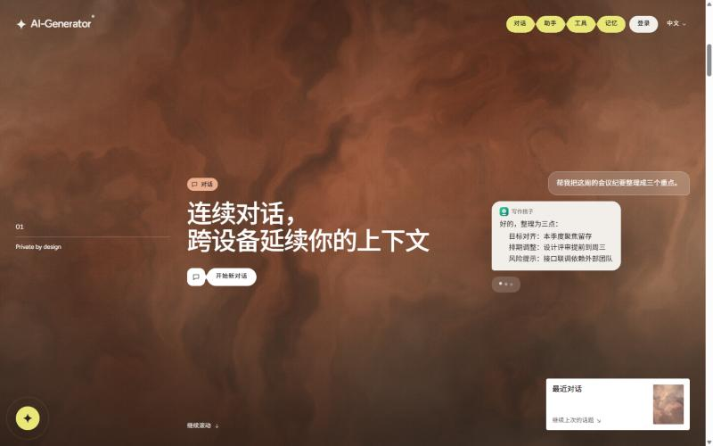

# 秋招 Demo 验收记录 · 2026-10-29

> 范围：`docs/recruitment-demo-sprint-2026-10-29.md`。分支 `demo/recruitment-20261029`，基于 `main@0e13d32`，PR #32（Draft → 待所有者合并）。
> 未修改数据库 Schema、migration、RLS、认证、Provider、环境变量或生产环境；README 未改动。

## 结论

| 项目 | 结果 |
|---|---|
| 主页桌面 1440×900 / 移动 390×844 | ✅ 无可见错误、无横向滚动 |
| 登录 → 工作台 | ✅ `/enter` 未登录跳转 `/login?next=/workspace`，登录后回到 `/workspace` |
| 工作台入口（对话 / 人格 / 记忆 / 工具） | ✅ 全部指向真实页面；Agent 运行标注「开发中」 |
| 真实 AI 对话 | ✅ 默认助手流式返回真实回答（约 20 秒） |
| 真实文本工具（总结 · 要点列表） | ✅ 约 5 秒返回真实结果 |
| 长期记忆读取 / 提取 | ❌ 数据库缺少列，见「阻断项」 |
| 人格头像接口 | ❌ 500，同一原因 |

## 截图（真实运行，非设计稿）

公开页面：

| 主页 · 桌面 | 主页章节 · 桌面 |
|---|---|
|  |  |

| 主页 · 移动 | 主页章节 · 移动 |
|---|---|
|  |  |

登录后的工作台、对话结果和工具结果截图包含账户名称与历史对话标题。仓库是公开的，所以这些截图没有提交，已单独交给项目所有者。

## 本轮改动

- **主页**：Hero 增加「开始体验」（→ `/enter`）与「查看源码」；去掉 Phase / Lumen 等内部用语；Agent 模式标注「开发中」；移动端章节显示产品插图；固定导航下方增加纸色渐隐，正文不再压在 Logo 下；预加载最短 1.1 秒，并在 4 秒后必定结束。
- **工作台**：快速启动改为 AI 对话 / 专属人格 / 长期记忆 / AI 工具；侧栏、移动菜单、⌘K、顶栏、对话输入提示和 `/agents` 均注明 Agent 模式「开发中」。
- **工具页**：改为与工作台一致的平面卡片，去掉模糊光晕和渐变面板，路由与数据不变。
- **页面标题**：各页英文大写 eyebrow 改为中文标签。

## 验证命令

| 命令 | 结果 |
|---|---|
| `pnpm lint` | ✅ 0 warning |
| `pnpm typecheck` | ✅ |
| `pnpm test` | ✅ 150 文件 / 863 通过 / 51 跳过（数据库集成测试需本地 Supabase） |
| `pnpm build` | ✅ 18 个静态页面，`/` First Load 116 kB |
| GitHub CI（PR #32） | build / lint / typecheck / unit tests / Node 24 / authenticated Playwright（desktop、mobile）通过；WebKit 与 Supabase Security Acceptance 记录时仍在运行 |

浏览器验收只使用 Claude 应用内置浏览器面板（单标签页，本地 `next start` :3100），由所有者本次授权；结束后已停止服务并确认无残留进程。未启动 Edge，未运行 Playwright / E2E。

## 阻断项与所有者操作

1. **数据库落后于 `main`（最重要）。** 本地 `.env` 指向的数据库有 6 个 migration 未应用（`prisma migrate status`，只读检查）：
   `20260724120000_add_trusted_memory_proposals`、`20260727013753_add_memory_verification`、`20261028074859_asset_deletion_consistency`、`20261028080215_asset_deletion_cascade_retry`、`20261028081301_asset_attachment_fence`、`20261028081742_validate_asset_ownership`。
   影响：对话时长期记忆读取与提取失败（对话本身仍可回答），人格头像接口返回 500。若生产环境使用同一数据库，生产站点也会出现同样问题。需所有者确认目标库后执行 `prisma migrate deploy`。本轮按范围约束未执行。
2. **Vercel Preview 受部署保护。** 预览地址会跳转到 Vercel 登录，面试官无法直接访问。如需对外展示，请在 Vercel 生成分享链接或调整 Deployment Protection；预览环境的 Supabase / AI 变量本轮无权限查看，未验证。
3. **主工作区 `.env.local` 是 E2E Mock 配置。** 其中 AI 地址指向 `127.0.0.1:4319`（Playwright mock provider）。用它启动演示会得到「AI 服务暂时不可用」。演示请只使用 `.env`（真实 Provider）。
4. **验收产生的数据。** 所有者账户中新增 2 个对话（1 个因上述 Mock 配置失败，1 个成功）和 1 条总结工具记录，可按需删除。

## 访问地址

- 本地：`pnpm build` 后 `pnpm start -p 3100` → <http://localhost:3100>
- Vercel Preview（需 Vercel 登录）：<https://ai-generator-git-demo-recruitment-20261029-man-dik.vercel.app>
