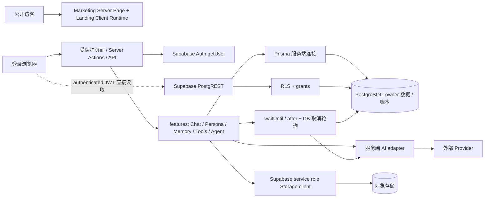
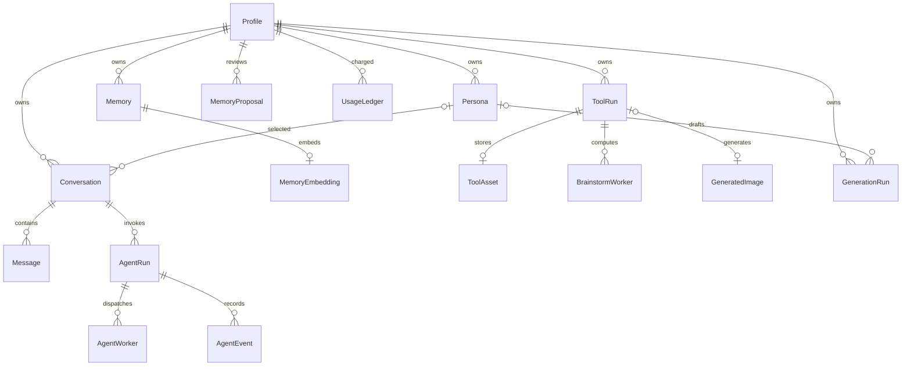

# AIG 源码现状与差距审计

> 2026-10-28，P0 内部审计；只读源码，未运行生产请求或迁移。  
> 锁定 `main = e33ac216bdcffc44d12d4b7315e0d6cc48decf5c`，Git tree `8372e935e331688d6007b3433849c8efa8f6d10e`。本地导出自 PR #25 head `a0050aaf4fc16e1cadd110918c3354a29e8d99fe`，其 tree 与 main 相同；导出不是 main 的 Git checkout。远程锁定依据见交付索引/CI 审计。

## 证据口径

- **Verified**：在固定 tree 的代码、版本化 SQL 或清单中直接看到；不等于运行行为已通过。
- **Inferred**：从代码路径推导的风险、架构建议或待实现设计。
- **Unverified**：没有本轮运行证据，包括生产 grants、私有 Storage 配置、真实 Provider、端到端可用性和 Owner 视觉验收。
- 本文路径/行号均相对上述 tree；可复现清单见 [source-inventory.json](evidence/source-inventory.json)。审阅重点为授权、运行、上传、账本、数据关系与公开 Landing，非对每行代码进行形式化证明。

## 1. 已实现的路由与服务层

**Verified**：`app` 有 24 个 `page.tsx`，`app/api` 有 24 个 `route.ts`；另有 `/enter` 与 `/auth/callback` 路由。页面/HTTP method 全量清单在证据 JSON 中。

| 路由族 | 当前能力与入口 | 核验结果 |
|---|---|---|
| `/` | `app/(marketing)/page.tsx` → `LandingPage`；服务端中/英文选择、metadata；独立样式/runtime | Verified；不依赖登录刷新，见 `lib/auth/supabase/middleware.ts:12` |
| `/enter`、`/login`、`/register`、`/auth/callback` | 入口跳转、密码登录/注册、Supabase callback | Verified；安全 return path 在 `lib/auth/return-path.ts:8` |
| `/workspace` | `app/(platform)/workspace/page.tsx:8` 调 `requireUser` 后显示 `features/home` | Verified；不是公开 Landing |
| `/chat`、`/chat/[conversationId]` | Chat、bootstrap、SSE、消息取消/状态恢复 | Verified；`app/api/chat/route.ts`、`features/chat` |
| `/personas/*` | CRUD、归档/回收站、AI 草稿、头像生成及 apply | Verified；`features/persona/actions.ts:30` 等先取真实用户，再按 owner 写 |
| `/memories` | 长期记忆、审核、proposal、验证来源、语义检索 | Verified；`features/memory`、后两条 memory migrations |
| `/tools/*` | 文本工具、图片理解/生成、Brainstorm、历史、取消与资产访问 | Verified；`features/tools` 和对应 API |
| `/agents`、`/agents/[agentRunId]` | Planner/Worker/Leader、事件、状态、终态查询、取消 | Verified；`features/agents/service.ts:46`、`app/api/agents/route.ts:20` |
| `/account`、`/admin` | 账户概览、主题、记忆入口、登出；服务器角色管理 | Verified；`app/account/page.tsx:17`、`features/admin/actions.ts:25` |
| Explore / Project / Developer / Connections | 没有对应 Project 实体/页面/API | Verified（本 tree 清单）；不得在 UI 中声称已上线 |

**Verified**：API 通过 Supabase `auth.getUser()` 验证身份，服务端 actions 使用 `requireUser`/`requireAdmin`。`requireAdmin` 读取数据库 `Profile.role`，而不是信任 `user_metadata`（`lib/auth/session.ts:7,28`）；`ensureProfile` 只从 metadata 读 display name，不从中赋管理员角色（`lib/auth/profile.ts:5`）。页面 middleware 只覆盖指定平台前缀；新增 API 的授权不能依赖 middleware 自动完成。

### 当前调用/信任边界图

**Verified**：这是源码已存在的路径，不包含拟议的 Project Registry/Vault/远程 Adapter。**Inferred**：Prisma 与 service role 是高权限边界，应用查询中的 `userId` 谓词不可由浏览器传入值替代；RLS 不能替可信连接弥补漏掉 owner 的查询。**Unverified**：生产 Prisma 角色、数据库网络暴露、Storage bucket policy 与迁移部署版本。

## 2. 依赖与可复用资产

| 资产 | 固定 tree 中的版本/实现 | 平台化复用判断 |
|---|---|---|
| 运行栈 | Node `22.x`、pnpm `11.7.0`、Next `15.5.20`、React `19.1.8`、TypeScript `5.9.3` | Verified（`package.json`）；Inferred：保留现有栈，避免把 P1 变成升级框架 |
| 数据/Auth | Prisma `6.19.3`、supabase-js `2.110.2`、SSR `0.12.0` | Verified；可复用身份与连接管理，不代表已实现项目成员权限 |
| 校验/测试 | Zod `4.4.3`、Vitest `4.1.10`、Playwright `1.61.1` | Verified；新增契约需真实 schema/HTTP/数据库负例 |
| 视觉/动效 | Landing 使用 Lenis `1.1.13` 与自写 RAF；GSAP `3.15.0` 在依赖中 | Verified；不能仅因 GSAP 已安装就声称 Landing 由 GSAP 驱动 |
| 图像处理 | Sharp、文件头识别、像素限制、重编码 | Verified；适用于现有 PNG/JPEG/WebP，不能推广为 DICOM/NIfTI 已支持 |
| Provider adapter | `lib/ai/config.ts:196` 读服务器环境变量；`openai-compatible.ts:207` 发带 Bearer 的 HTTP 请求 | Verified；新增选择层保留现有调用契约 |
| UsageLedger | 持久配额账本、Serializable reserve、幂等键 | Verified；平台调用额度可复用思想，Provider 真实账单仍需单独对账 |
| Agent event/state | owner 复合键、event sequence、持久终态、DB 取消 | Verified；可复用状态不变量，不等于耐久执行队列 |

**Verified**：少数 dependency 范围（如 `sharp`、`tsx`、`server-only`）不是精确 pin；`pnpm-lock.yaml` 才确定解析版本。**Unverified**：本轮未进行新一轮线上漏洞库扫描，不把历史 `pnpm audit` 的零漏洞数字视为当前结果。

## 3. 数据模型及迁移现状

**Verified**：`prisma/schema.prisma` 有 18 个 model，17 个版本化 migration 目录。最新两条为 `20260724120000_add_trusted_memory_proposals` 和 `20260727013753_add_memory_verification`。不存在 Project、ProjectVersion、Installation、ProjectGrant、ProjectRun、Credential 或 EndpointRegistry model。

图为 **Verified** 的核心关系简图；非完整 FK 图，ModelConfig/AppSetting 是全局配置，未在图中表示。具体约束以 schema 与 migrations 为准。

### 需要保留的已修复约束

- **Verified**：UsageLedger `(userId,runId)`、`(userId,idempotencyKey)` 唯一（schema:226；`20260722160000_strengthen_usage_idempotency`）。账本按 Profile 关联，不按可删除 ToolRun/Conversation 级联；删除账户的最终保留策略需另定。
- **Verified**：AgentRun↔Conversation、Worker/Event↔Run、BrainstormWorker↔ToolRun 已用 owner 复合关系（schema:274,425,467,487）。Agent 的消息关联限制 conversation；SQL trigger 检查消息 role。
- **Verified**：MemoryProposal 的 persona、target/resolved memory、source conversation 已有 owner 复合 FK；最新 memory verification migration 对旧自动提取内容标记 `LEGACY_UNREVIEWED`，不是全部视为已确认。

### 仍需设计和验证的约束

- **Verified**：ToolAsset→ToolRun（schema:321）、GenerationRun→Persona（298）、Conversation→Persona（369）、Persona→avatarImage（351）、Memory 多个来源（520–522）、MemoryEmbedding→Memory（591）仍有单 ID FK。
- **Inferred**：未来可信服务器 bug/脚本可制造跨 owner 引用；目前 select-own 策略与业务验证降低风险，但不能代替数据库不变量。新增复合 FK 前先只读扫描存量，后续单独 migration；本轮不把它误报成已复现的普通用户越权。
- **Unverified**：生产孤儿、错误 kind、Storage path 重复、Worker 状态/时间组合异常，以及所有版本 migration 的生产应用状态。

## 4. 历史安全事项重新核对

| 旧审计项 | 当前固定 tree 取证 | 本轮判断 |
|---|---|---|
| Profile 自提权 | `20260722120000...:281–283` 撤销表级权限，只开放白名单列 UPDATE；`:141–163` trigger 保护 role/id/email/时间；`:125` 注册角色固定 USER | Verified：修复已进源码；Unverified：生产应用效果；不能再写“当前普通 JWT 可提权” |
| 直接伪造/删除运行 | 同 migration:285–316 撤销 PUBLIC/anon/authenticated 写权限，恢复 authenticated SELECT；select-own policies；memory_proposals 后续 migration 同样收紧 | Verified：源码已修；Unverified：生产 PostgREST 负例 |
| 删除历史恢复额度 | `features/agents/creation.ts:38–146` 配额统计、run/message/账本写入同 Serializable 事务；Tools/Chat 使用独立 ledger | Verified：已实现保护；不是按旧历史重新计数 |
| 手工 RLS 漂移 | grants/trigger/check/FK 在版本化 migration；`prisma/rls.sql:1` 标为灾备恢复基线 | Verified：机制已改；Unverified：生产 migration SHA/policies |
| SSE 断连取消后台 | `features/generation/sse-observer.ts:56` 只 detach；DB 取消轮询在 durable-cancellation | Verified：传输与显式取消分离；不能据此宣称实例回收后可续跑 |
| Agent 耐久执行 | `background-task.ts:15–30` 注册已启动 Promise；`app/api/agents/route.ts:16` 300 秒；`run-state.ts:166` stale 转 ERROR | Verified：没有在已审路径看到重派发/lease/checkpoint；Inferred：进程消失会失去未落库工作，GPU 不可直接复用 |
| 上传 10 MB | `processor.ts:6–7` 10 MiB/4000 万像素；`image/run/route.ts:37–39` Content-Length 粗筛后先解析整个 multipart | Verified：仍走 Function 代理上传；Unverified：真实平台请求体边界/内存峰值，不能保证大文件可用 |
| 安全响应头 | `next.config.ts:3–7` 无 `headers()`；源码未见 CSP/frame-ancestors 配置 | Verified：仓库层缺；Unverified：CDN 是否补头；后续 Embed 前必须完成 origin/CSP 验收 |
| 仅 mock 的“集成” | `tests/integration` 已有 usage、RLS、memory proposal/verification 的真实 DB 套件；`database.ts:5` 三重环境开关；global-setup:15 缺配置即报错 | Verified：已改善；本轮未执行数据库套件，精确 CI 结果见 CI 审计 |

### 新增隐私失败路径：删除元数据前没有保留清理重试依据

**Verified**：`features/tools/image/assets.ts:9–10` 在 Storage 删除失败时记录错误并返回；调用者 `features/tools/actions.ts:14–16` 随后继续删除 ToolRun；schema:321 对 ToolAsset 为 `onDelete: Cascade`。  
**Inferred**：Storage 暂时失败时，UI 可能报告历史已删除，数据库资产路径却随级联消失，剩余对象不再进入基于 ToolAsset 的到期扫描。不是本轮已复现事故，但这是可定位的失败控制流。P2 删除契约应使用持久 deletion job/tombstone 与重试，在真正完成前显示待清理状态。**Unverified**：生产是否存在孤儿对象、Storage 生命周期规则是否另行兜底。

## 5. 平台化差距与兼容边界

| 能力 | 当前现状 | 下一阶段所需（Inferred / DRAFT） |
|---|---|---|
| Project 一级实体 | Verified：缺模型、API、发布版本与目录 | P1 Registry + 不可变 Version + 最小 private/member read |
| 三维可见性 | Verified：现有大多 owner-only；无项目 visibility/grant | P2 分离 project visibility、asset ownership、capability grants |
| BYOK | Verified：配置来自服务端环境；无用户 vault/credential lifecycle | P5 KMS、AEAD、授权、轮换、撤销、费用边界；不扩用现有环境 Key |
| 第三方执行 | Verified：没有受审查 Endpoint Registry/adapter 协议 | P3 协议；P4 allowlist、egress、签名回调、耐久队列，仅合成数据 |
| 跨服务删除/导出 | Verified：账户页只有计数/记忆管理/登出，无完整导出删除旅程 | P2 元数据+对象+衍生物+备份策略、可审计作业 |
| 可观测性 | Verified：已有部分 request/run 结构化日志，账本预留 token/cost；未见统一跨服务 trace/真实 cost finalize | P4/P5 provider request id、价格版本、全局并发、账单对账 |
| 研究展示 | Verified：当前 Landing 的 mock 产品插图不是真实 CTMR 指标 | P1 Presentation 声明证据等级，获准合成资产；CTMR 详见专项审计 |

**Inferred / DRAFT**：旧 `/chat`、`/personas`、`/memories`、`/tools`、`/agents`、Supabase 用户 ID、原 API payload/SSE、旧历史/配额语义保留。AI Hub 先重分组导航，ProjectRun 是新实体，不改写已有 AgentRun 状态枚举。新增路由加入 `safeReturnPath` 白名单须独立验收，不能给任意外站跳转开口。

## 6. 结论及本轮未执行项

**Inferred**：现有身份、owner 数据层、账本与 AI 能力可复用，适合增量平台化；不需要重写 Chat/Memory/Agent。当前不具备第三方运行、BYOK 或医学数据上线依据。具体 GO/NO-GO 与阶段 Gate 在发布计划中统一登记。

**Unverified / 本轮未执行**：生产查询、migration、真实 Auth/RLS 攻击测试、端到端 Provider 调用、GPU/进程 kill、Browser 屏幕/录屏、性能和大文件上传。源码静态取证、JSON inventory 和哈希结果不能替代这些验收。

固定源码参考：[Prisma schema](https://github.com/ManDik-Chan/AI-Generator/blob/e33ac216bdcffc44d12d4b7315e0d6cc48decf5c/prisma/schema.prisma)、[安全 migration](https://github.com/ManDik-Chan/AI-Generator/blob/e33ac216bdcffc44d12d4b7315e0d6cc48decf5c/prisma/migrations/20260722120000_security_hardening_rls_usage/migration.sql)、[后台生命周期](https://github.com/ManDik-Chan/AI-Generator/blob/e33ac216bdcffc44d12d4b7315e0d6cc48decf5c/features/generation/background-task.ts)。
