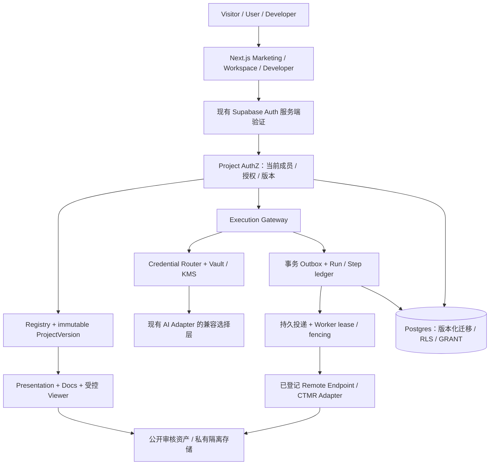

# 目标架构与兼容边界

> INTERNAL · DRAFT · **Inferred / Proposed**；当前实现证据见 [源码审计](01-source-audit.md)。

## 增量架构

## 建议文件边界（尚未创建）

| 位置 | 职责 | 约束 |
|---|---|---|
| `features/projects/{registry,versions,authorization,presentation}` | 领域操作与 DTO | 所有 mutation 由可信服务端执行；公开 DTO 不复用内部 Prisma 对象 |
| `app/api/v1/*` | HTTP、认证、输入上限、CSRF/错误映射 | 不改旧 Chat/Tools/Agents 路径；浏览器 cookie 写请求校验 Origin/CSRF |
| `lib/platform/runtime` | Run 状态机、outbox、step、回调 | HTTP 202 仅在事务持久化成功后返回；实例内 Promise 不是队列 |
| `lib/platform/credentials` | 凭据元数据、AEAD、短期解密、授权检查 | 与第三方 Adapter 分进程/身份，日志不可写 Key；后台子调用明确授权 |
| `lib/platform/egress` | Endpoint Registry、解析/连接地址校验 | Manifest 不提供任意 URL；OpenAPI servers 只作说明，不能变成网络权限 |
| `lib/platform/storage` | Upload intent、quarantine、扫描与提升 | 不把大文件通过 Next route 完整缓冲；签名 URL 不能替代所有权检查 |

## 信任与身份

浏览器身份经现有 `getUser()` 验证；客户端 projectId、role、userId、费用、状态、存储路径都不可信。服务端 Prisma 连接可能具有超越 RLS 的权限，必须显式按 authenticated subject 限定查询；不能因部署了 RLS 就省略服务层授权。

第三方描述、Markdown、Manifest、模型输出均是数据：禁 HTML/脚本、危险 URL 和远程 `$ref` 自动抓取；Viewer 按 allowlist 注册，不能从 Manifest import 任意组件。第三方 Embed 未来在独立 origin、最小 sandbox 和精确 postMessage origin 下运行，不收到 AIG Cookie/Token。

## 持久任务 Spike（P0 设计结论，运行结果 Unverified）

候选 A：托管 durable workflow；候选 B：Postgres transactional outbox + 持久队列 + 独立 Worker。选择前比较投递保证、故障恢复、运行时上限、区域/数据去向、可观测性、运维和实际成本，不预设 Redis/Kafka。

共同底线：同事务写 Run、额度 reservation、outbox；消费者使用租约和递增 fencing token；回调 eventId 去重；每个外部调用有 stepKey 与 providerRequestId；回调/租约/授权过期均拒绝旧 attempt。无 Provider 幂等支持时不得声称 exactly-once，未知结果先对账而非盲重试。长 GPU 推理留在独立 Python/CUDA Worker。

验证矩阵：投递前后 kill、Provider 响应前后 kill、Worker 重启、重复投递、租约过期与旧 Worker 回写、取消/成功并发、乱序回调、撤销后迟到回调、24h 补偿扫描。必须测队列丢失窗口和每 step 的重复计费风险。P0 不启动外部服务、不写数据库，因此尚无 Spike 实测胜者。

## BYOK 设计

Credential 元数据与 ciphertext 分表；AEAD 绑定 credentialId、owner、provider、keyVersion 作为 AAD；随机 nonce 不复用，KMS 管理 wrapping key，轮换采用新版本密文和后台受控重加密。主密钥与数据库不共存。持久模式与会话模式均只能在网关解密，后者不得入数据库/队列/日志，生存期及销毁机制需实测。

调用显式选择 `PLATFORM` 或 `BYOK`，BYOK 绑定 credentialId + model + 有效 CredentialGrant；失败不切换到平台 Key。远程开发者服务使用平台代理的受限能力，永不接收用户 Provider Key。平台额度与 Provider 费用分开记录；未知费用显示未知。用户撤销/轮换后新调用立即失效，已在第三方的请求无法承诺收回或远端删除。
