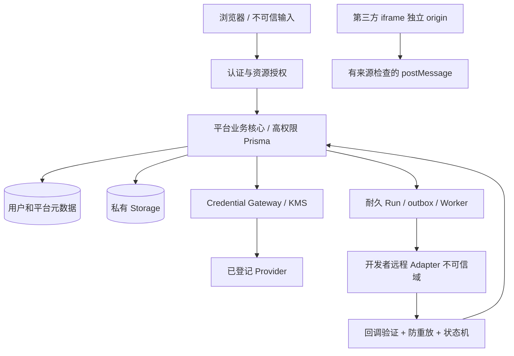

# 平台安全威胁模型

> P0，2026-10-28；内部；DRAFT。现状依据 `main e33ac216bdcffc44d12d4b7315e0d6cc48decf5c`。  
> **Verified** 指固定源码可见；**Inferred** 指威胁推演/拟议控制；**Unverified** 指缺少真实运行/生产证据。下面所有新平台控制均为 Inferred / DRAFT，不表示已经生效。

## 1. 资产、主体与边界

| 资产/主体 | 需要防护的边界 | 当前证据 |
|---|---|---|
| 用户身份、Profile.role | 浏览器/JWT → Auth → 业务授权 | Verified：`getUser` + 数据库角色；role 白名单列授权与触发器保护 |
| 用户正文、图片、记忆、历史 | 当前 owner；未来项目作者/协作者也不得默认读取 | Verified：主要查询 owner-scoped；生产 grants 为 Unverified |
| 服务端平台 Key / service role | 浏览器、日志、SSE、第三方源不得接触明文 | Verified：配置为服务器环境；Supabase admin 模块 `server-only`；完整日志审计仍 Unverified |
| 用户 BYOK | 用户 → CredentialGrant → Gateway → 指定 Provider | Verified：尚无 vault 实体；Inferred：所有原始 Key 只能在受控服务端解密 |
| Manifest/Presentation/OpenAPI | 开发者输入是不可信数据，不能授权自己或指定任意 egress | Verified：当前未实现；Inferred：schema 白名单、版本快照、审核后 registry |
| 运行/账本 | 客户端、远程 Worker、迟到/重复回调、进程回收 | Verified：已有 ledger/DB 终态保护；ProjectRun/耐久 Worker 未实现 |
| 公共演示资产 | 只有单独审定资产可公开；Project=PUBLIC 不推导 Run=PUBLIC | Inferred：资产/项目/能力授权必须独立 |
| 医学资料 | 头信息、像素烧录文本、网格/报告等衍生物 | Inferred：V1 仅合成或经授权审查样例；真实病例上传未获准 |

图为 **Inferred / DRAFT** 的目标安全边界；KMS、Gateway、outbox、Remote Adapter、iframe 协议在当前 AIG 中未实现。

## 2. 威胁与验收矩阵

| ID | 场景与影响（Inferred） | 已有证据 / 缺口 | 必需控制和真实负例（DRAFT） | 阻断阶段 |
|---|---|---|---|---|
| T01 BOLA/IDOR | A 猜 B 的 project/version/run/artifact/credential ID | Verified：旧查询普遍带 owner；新实体缺失 | 每个入口统一授权；visitor、owner、member、non-member、admin 负例；不可枚举资源统一 404；列表/计数/搜索同样过滤 | P1/P2 |
| T02 客户端状态伪造 | JWT 直连 PostgREST 改角色、grant、终态、账本 | Verified：旧表已 REVOKE 写；新表无策略 | 新表迁移先 RLS+GRANT；真实 JWT 绕过应用直测；不能只测 mock；admin 不能默认读取私有正文 | P2 |
| T03 关系污染 | 可信脚本把 A 的资产挂 B 的 run | Verified：仍有单 ID FK；见源码审计 | 先查存量，再复合 owner FK/kind/check；插入跨 owner/错误版本/错误 kind 必须失败 | P2 |
| T04 Secret 泄漏 | Key 经错误、SSE、iframe、SDK payload、日志或 Preview 外传 | Verified：现有 server-only/config 和错误脱敏；用户 Vault 缺失 | 元数据/密文分离；AEAD 独立 nonce；KMS 版本与轮换；审计不含明文；canary Key 跨边界扫描；销毁/撤销测试 | P5 |
| T05 隐性转移/费用 | BYOK 失败静默换平台 Key 或其他 Provider；后台 Memory 未获准调用 | Verified：当前无用户 BYOK；后台 Memory 有独立 Provider 路径 | 必须显式 provider/credential/model/capability/audience/expiry；不静默 fallback；每个子调用有 grant 和独立成本维度 | P5 |
| T06 SSRF/重绑定 | 自定义 endpoint/OpenAPI server 指向内网/metadata、重定向逃逸 | Verified：当前 AI endpoint 为运维环境配置；image downloader 有初步 URL/DNS/重定向检查 | 禁止任意 URL；审核 registry；协议/端口/所有 DNS 地址检查；连接到已校验地址并验证 TLS/SNI；网络 egress 为最后边界；DNS rebinding/IP 编码/IPv6/redirect 真实测试 | P3/P4/P5 |
| T07 第三方前端越权 | iframe 取得父站 Cookie/token、伪造 postMessage、导航/钓鱼 | Verified：当前无外部 embed；仓库无 CSP headers 配置 | 独立 origin，最小 sandbox/Permissions-Policy/CSP；精确校验 origin/source/schema/nonce；不向第三方传平台 JWT/Key；任意 HTML 不在主站执行 | L1 开放前 |
| T08 异步丢失/重复计费 | 接受任务后进程 kill；Provider 成功后 DB 未提交；重复回调 | Verified：旧任务 Promise 生命周期；没有 durable dispatch | 事务写 run+outbox；worker lease/fencing/heartbeat/checkpoint；step ledger+provider request id；区分未知调用结果，不能承诺 exactly-once 外部计费；逐点故障注入 | P4 |
| T09 取消/撤销竞态 | Grant 撤销后排队任务仍启动，迟到成功覆盖 CANCELLED | Verified：旧终态/取消有 DB 条件更新；新 grant 不存在 | 接受和 dispatch/step 再检有效 grant；撤销事务使未启动任务失效；运行中 cancellation generation；回调校验 attempt/fence；终态 CAS | P2/P4/P5 |
| T10 回调伪造/重放 | 恶意 Worker 写别人的状态/对象，重放成功耗预算 | Verified：当前无项目回调 | HMAC/mTLS/OIDC 选型后真实测试；时间窗、nonce、delivery ID unique、body digest、endpoint/version/audience 绑定；密钥轮换双版本窗口 | P4 |
| T11 上传消耗/污染 | 巨大 multipart、zip bomb、错类型、path 覆盖、解码 OOM | Verified：当前先解析 multipart；图像 10 MiB/40M px、Sharp 重编码 | private quarantine 受控直传；upload intent 绑定 owner/run/size/hash；分块/到期/未完成清理；扫描后 promote；大小/像素/并发/超时/费用限额；10MB+ 真实路径验收 | P4 |
| T12 删除未完成 | Storage 失败后 DB 级联删除，失去重试依据 | Verified：`assets.ts:9–10` return；`actions.ts:14–16` 继续 delete；schema:321 Cascade | durable deletion job/tombstone；重试退避/死信/告警；删原始/衍生/索引/对象；备份按公布保留期；故障时用户看到待处理状态 | P2 |
| T13 Signed URL 外泄 | 被分享/日志留存的 URL 在授权撤销后仍可访问 | Verified：ToolAsset URL TTL 60 秒；实际 bucket 配置 Unverified | 最小 TTL；下载前授权；敏感内容禁公开分享；撤销需明示已发 URL 窗口，必要时删除/换对象 key；到期/跨用户测试 | P2 |
| T14 医学重识别 | 标签、像素文字、报告、几何形态泄漏身份 | Unverified：无脱敏管线验收 | 不接真实患者输入；资产逐个 provenance/许可/去标识检查；不得称“去标识=零风险”或临床诊断 | P6 |
| T15 不可信研究内容 | 模型/文档提示注入、假指标、危险下载、HTML/XSS | Verified：当前 Presentation/Manifest 尚未实现 | Markdown sanitize/无任意 HTML；指标带数据集/方法/版本/证据状态；下载和文档不拥有运行/密钥权限 | P1/P3 |
| T16 资源/成本滥用 | 多 run 并发、长时间 GPU、重试放大 | Verified：现有每日 ledger；未见全局 durable semaphore | 用户/项目/全局并发与预算；deadline、最大输入输出存储；熔断、取消、provider usage 账单对账 | P4/P5 |
| T17 审计越权 | 运维/开发者日志读取用户正文、凭据或病例 | Verified：部分日志仅 ID/错误码；完整外部 SDK/运维日志 Unverified | 开发者只看项目聚合和错误码；Break-glass 必须理由/时限/审计；生产日志脱敏扫描与访问审计 | P2/P5 |
| T18 前端可用性与泄漏 | 新页面可见假能力，Private 数据进 metadata/cache/sitemap | Verified：已有公开页和私有页分离；新项目缓存未定义 | private 响应 private/no-store；public DTO 字段白名单；cache key 含权限上下文；sitemap/OG/search 不索引 Private 或 Unlisted | P1/P2 |

## 3. 现状中需要特别精确的判断

1. **Verified**：`lib/ai/image/download.ts:48–67` 对 HTTPS、localhost、所有解析 IP 与跳转逐次检查；`:85–87` 随后调用普通 `fetch`。**Inferred**：校验 DNS 与连接 DNS 之间未看到地址 pinning，不能当成未来任意远程 endpoint 的完整 SSRF 防线；也没有证明当前用户能直接控制该下载 URL。禁止把“存在地址检测”误写为 DNS rebinding 已防住，或反向写为已复现内网利用。
2. **Verified**：`createDurableCancellationController` 把已落库取消转为 AbortSignal；它不保存 CPU/GPU 执行栈，也不重发丢失任务。任务可恢复与 UI 能恢复查询是两回事。
3. **Verified**：旧安全 migration 撤销 `PUBLIC/anon/authenticated` 写权限，角色注册固定 USER；这些不是本轮尚未修的 Critical。**Unverified**：生产 migration、`pg_policies`、schema grants/default privileges、Storage policies，未登录生产确认。
4. **Verified**：ToolAsset 签名跳转前校验 owner/expiry（`app/api/tools/assets/[assetId]/route.ts:10–14`）。**Inferred**：公开 Project 不应绕过该现有规则；新资产还需按资源独立授权。

## 4. 建议的安全不变量（Inferred / DRAFT）

- **项目可发现性不是资源授权**：`PUBLIC/UNLISTED/PRIVATE` 仅影响项目展示；run 输入/输出默认 owner-only。UNLISTED 是持链接可见的发布内容，不是 Private。
- **版本不可变**：Manifest、OpenAPI、Presentation、capability 列表、processor/data policy 绑定发布版本及 digest；危险权限变化重新审核、重新授权。
- **授权来自服务器**：客户端不能通过 payload 选择 owner/role/credential audience；installation 不授予运行权，grant 不授予开发权。
- **撤销取当前状态**：缓存/队列/回调不能仅凭任务创建时 grant 快照放行；已撤销的 grant 不可启动新 step。历史 grant snapshot 只用于审计。
- **明确失败**：授权不足、Key 撤销、模型不支持、未知 Provider 计费结果必须明确反馈，不跨 Provider 静默补跑。
- **删除可恢复**：删除状态是持久业务作业；对象失败保留 tombstone、路径与重试依据，直至作业完成。
- **Secret 只在最小调用窗口解密**：不承诺平台绝对无法读取；会话模式也说明服务端短暂持有。远程开发者永不收到用户 Provider Key。
- **生产验收独立**：本轮文档、静态 JSON 校验及 CI 文件存在，不替代真实 Auth/RLS、Worker kill、SSRF、上传、医学资产与 Owner 上线验收。

## 5. 阻断与验证归属

**Inferred**：P1 可以先设计并实现无第三方执行的成果展示，但必须先通过最小 Public/Private 隔离和视觉回归；P4/P5/P6 不能凭 P0 文档完成解锁。Codex 负责服务端和故障负例，Claude 负责权限告知/无假能力/可访问性，Owner 决定数据策略和最终开放。

**Unverified**：本轮没有接触生产数据、Key、Auth token、真实患者样例或执行外部代码，没有跑写库测试。各攻击场景是后续真实验收用例，不是已经通过的结果。
