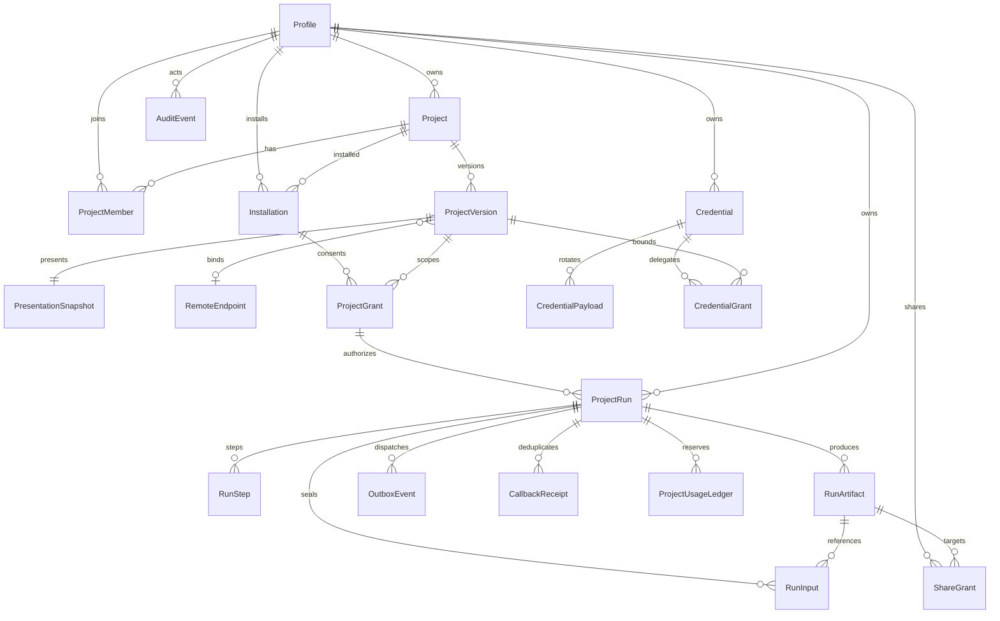
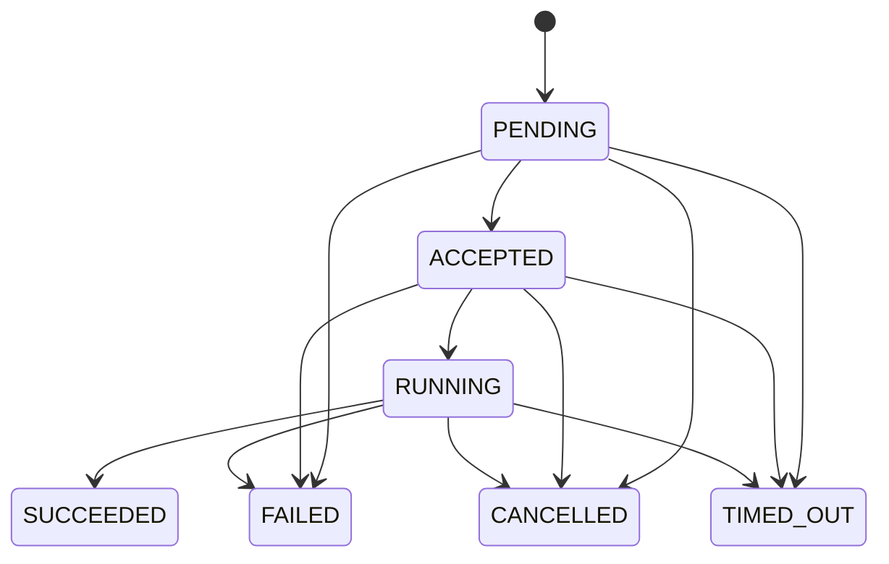

# 平台数据模型与 ERD 草案

> INTERNAL · DRAFT · **Inferred / Proposed**。以下是逻辑模型，不是 Prisma migration；全部新增表均未创建。现有 `Profile.id` 是 Supabase user UUID（`prisma/schema.prisma`），本案沿用。

## 字段与约束

| 实体 | 关键字段 | 数据库/领域不变量 |
|---|---|---|
| Project | id UUID、slug、ownerId、visibility、status、authzEpoch | unique slug；PRIVATE/UNLISTED/PUBLIC 与 Draft/Published 生命周期独立；owner 关系不可自助提权 |
| ProjectMember | projectId、userId、role、status | unique(projectId,userId)；所有者转移事务一致；移除成员提升 epoch |
| ProjectVersion | id、projectId、version、manifestSnapshot、manifestHash、openapiHash、presentationHash、capabilityContractsSnapshot、endpointRevisionId、reviewStatus、publishedAt | unique(projectId,version) 和 (id,projectId)；capabilityContracts保存每能力operationId与输入/输出Schema快照和hash；发布后快照不可变；更新权限/端点须新版本审核 |
| PresentationSnapshot | versionId、schemaVersion、contentHash、json | versionId unique；只关联审核资产，不包含私有运行结果 |
| RemoteEndpoint | id、revision、approvedOrigin、addressPolicy、authRef、status | unique(id,revision)；无用户自填 URL；版本绑定不可变 revision；停用立即生效 |
| Installation | id、userId、projectId、status | unique(userId,projectId)；(id,userId,projectId) 可作复合 FK；安装不默认同意所有能力 |
| ProjectGrant | id、installationId、subjectId、projectId、versionId、capability、scope、audience、expiresAt、revokedAt | 复合 FK 保证 Installation 与版本的项目/用户一致；不能仅凭 projectId 跨版本授权；scope 不接受任意脚本 |
| ProjectRun | id、ownerId、projectId、versionId、grantId、capability、state、attempt、fence、authzEpoch、revision、lastCallbackSequence、idempotencyKey、requestHash、parametersSnapshot、inputMode、inputSetHash、inputsSealedAt、executionSnapshot、deadlineAt、cancelRequestedAt、retentionClass | unique(ownerId,idempotencyKey)，保存原始创建requestHash；parameters/input set/execution分别固定与可恢复；executionSnapshot含mode、providerRef/model及credentialId/credentialGrantId/授权版本，不含密钥；联合 FK 防 grant/版本/主体串接；回调sequence按run/attempt持久CAS；终态不回到RUNNING |
| RunInput | runId、artifactId、ownerId、position、sha256 | unique(runId,artifactId)与(runId,position)；复合FK确保Run与输入同一owner；封存后不可增删；派发需全部APPROVED |
| RunStep | runId、stepKey、attempt、leaseUntil、fence、providerRequestId、state、resultCheckpoint | unique(runId,stepKey,attempt)；旧 fence 禁回写；无法确认外部副作用时进入对账，不盲重试 |
| RunArtifact | id、runId、ownerId、storageKey、dataClass、visibility、sha256、mime、size、expiresAt、deletedAt | (runId,ownerId) 复合 FK；默认 OWNER_ONLY；storageKey 服务端生成，非任意 URL；敏感不可 PUBLIC |
| OutboxEvent | id、runId、eventType、payloadRef、publishedAt、nextAttemptAt | 同 Run/额度事务创建；不含文件内容/凭据；至少一次投递，消费端去重 |
| CallbackReceipt | endpointRevisionId、eventId、runId、attempt、fence、sequence、bodyHash、receivedAt | unique(endpointRevisionId,eventId)与(runId,attempt,sequence)；相同event/hash重放幂等；同event不同内容或同序号不同event拒绝；lastCallbackSequence随状态事务CAS |
| Credential | id、ownerId、providerId、label、fingerprint、status、activePayloadVersion | unique(id,ownerId)；仅脱敏元数据；fingerprint 不采用可还原 Key 的前缀 |
| CredentialPayload | credentialId、keyVersion、ciphertext、nonce、tag、kmsKeyRef、createdAt、destroyedAt | unique(credentialId,keyVersion)；服务身份分离；nonce 每次随机，不复用；无客户端 SELECT |
| CredentialGrant | id、credentialId、subjectId、projectId、versionId、capability、audience、modelAllowlist、expiresAt、revokedAt | 复合 FK 绑定 Credential owner；一次用量不能串用户；版本/能力/模型/audience 必须全部匹配 |
| ShareGrant | id、ownerId、artifactId、tokenHash、expiresAt、revokedAt | 单独分享授权；仅保存 token hash；敏感资产拒绝公开分享；已签 URL 的有效期风险单独定义 |
| ProjectUsageLedger | id、ownerId、runId、reservationKey、platformUnits、providerCost、currency、pricingVersion | unique(ownerId,reservationKey)；append-only；平台额度与 Provider 估算/实账分开；不修改旧 UsageCapability enum |
| AuditEvent | actorId、action、targetType、targetId、reasonCode、timestamp、correlationId | 不写用户正文/Key/签名 URL；审计读取另设权限；管理员访问留原因和记录 |

## 生命周期

PENDING 表示 Run+reservation+outbox 已提交；READY 模式创建时封存输入（可为空），UPLOAD 模式等待显式 inputs/finalize，只在全部资产扫描通过后原子写RunInput/inputSetHash/inputsSealedAt并投递ready事件。逐项upload completion不能自动推断多文件齐备。原始requestHash不随封存改变。ACCEPTED 是受控执行端确认；RUNNING 是实际开始。cancelRequestedAt 先阻止新步骤，取消成功后才进入 CANCELLED；不能把 HTTP 请求取消等同远端计算已停止。超时由持久调度/补偿器确认。所有终态不可逆；成功/取消/超时争用 revision CAS，迟到结果隔离不提升。非终态执行重试创建新 attempt，重置lastCallbackSequence并递增fence；终态重跑必须新Run/新幂等键，不复活旧Run。若远端不支持取消，只能隔离结果并诚实显示远端仍可能消耗资源。

SESSION Credential 的持久元数据不包含secret；Run只保存其引用与expiry。进程重启导致volatile secret不可用时，任务必须停止并报告CREDENTIAL_EXPIRED/UNAVAILABLE，不能声称会话Key也具备跨重启耐久性或回落到其他Key。

## 删除与迁移

删除先建立不可读 tombstone，再撤销分享/签名权限并排队删除源对象、派生对象、临时分块、索引和远端副本；追踪逐项确认与重试。必要额度和审计保留按政策去标识化，不做全表 cascade 清除成本事实。备份留存、远端删除 SLA、账户导出/注销策略待 Owner 审批。

迁移顺序：expand 新表/约束/RLS/GRANT（默认 deny）→ 验证旧应用兼容 → feature flag 关闭状态部署 → 校验/回填（如需要）→ 有限开放 → 未来 contract。P1 不需要 Run/Credential 表；不应一次建齐 ERD。回滚优先关闭入口/回滚应用并保留安全约束与审计，已发布 migration 不改写、不恢复危险客户端写权限。
