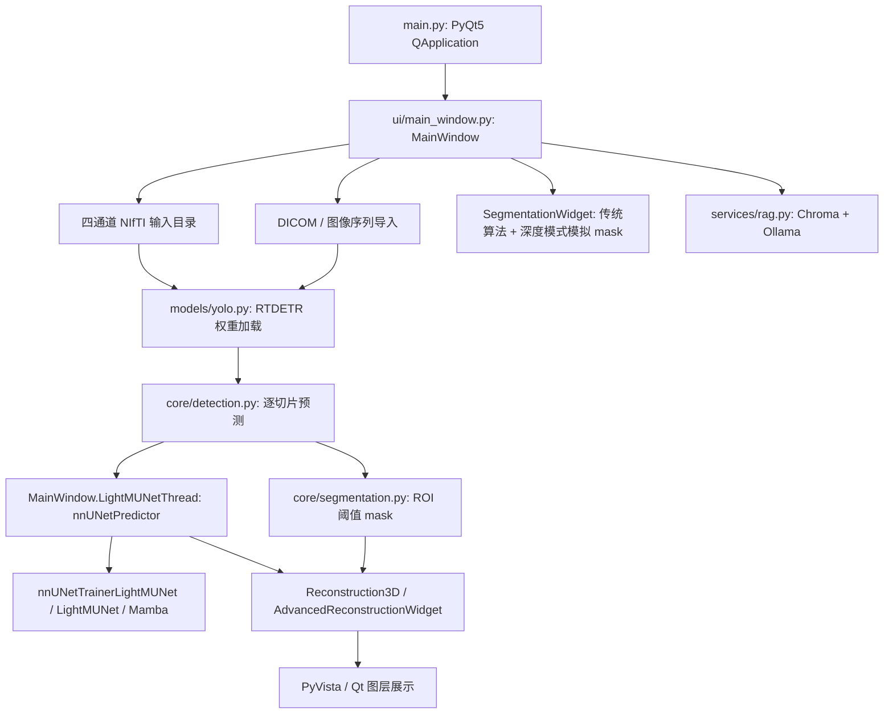

# CTMR_4C 参考接入审计与 Adapter 草案

> **状态**：P0 / INTERNAL / DESIGN-ONLY；未实现平台 Adapter。  
> **审计日期**：2026-10-28（Asia/Singapore）。  
> **源代码锁定**：`JNKL0620/CTMR_4C@ddb510499a690c286ca607dc876d757c62662813`；Git tree：`15213cbf95e62d9c37840d4fd2378798df6ec41d`。  
> **来源边界**：私有仓库，仅记录实现结论、路径与元数据；不得直接公开本文、私有源码、现有网格或知识库。  
> **证据等级**：Verified = 本轮读取固定 SHA 的源码/完整 Git 树或 GitHub API；Inferred = 基于源码的推论；Unverified = 尚无运行、测试或授权证据。Verified（源码）不等于已运行通过。

## 1. 审计结论

**NO-GO：当前快照不能直接接入生产远程推理，也不能宣称完整复现。** 可以继续设计 L0 展示模板，并等待作者批准可公开文字、模型卡及合成演示资产。实际上线仍受平台 P1/P2/P4/P6 Gate 约束。

- **Verified**：主入口是 PyQt5 桌面程序，存在检测、阈值分割、真实 LightM-UNet 推理调用、PyVista 重建与 Ollama/Chroma RAG 源码。
- **Verified**：某些“深度学习分割”界面实际生成圆形模拟 mask；必须与真实 LightM-UNet 路径分别说明。
- **Verified**：两份 checkpoint 是 Git LFS 指针；指定模型目录缺少加载器要求的 `dataset.json` / `plans.json`。检测配置引用的 `.pt` 权重未在固定树中找到。
- **Verified**：说明中的 React/Django Web 目录和启动脚本不在完整固定树中；依赖清单出现 Django/FastAPI 不能证明已有可调用 API。
- **Unverified**：实际权重可获取性、权重内容/训练来源、端到端执行、Dice/mAP、显存/延迟、跨平台安装、患者数据去标识化、医学有效性和公开资产授权均未验收。

路线图 §1.1 的 CTMR “Git Tree：ddb5104…” 应更正为 **commit SHA**；实际 tree 是上述 15213c…。完整 recursive tree 查询未截断，共 673 项（包含 tree/blob 条目，不等于 673 个源文件）。

## 2. 真实入口与调用关系

**Verified**：`main.py:1–12` 导入 `ui.main_window.MainWindow`，并非 HTTP 服务；`app.py` 也是 Qt 主窗体实现，不能因文件名视为 Web 应用。主调用链使用 `ui/main_window.py:49–104` 定义的推理线程。另有 `core/threads.py` 与 `models/lightunet_inference.py`，但不能把这些辅助入口自动当成主入口已验证的功能。

## 3. 能力清单：已实现 / 已测试 / 仅声明 / 待开发

| 能力 | 已实现（Verified，源码） | 已测试 | 仅声明或未核验 | 待开发 / 接入要求 |
|---|---|---|---|---|
| DICOM 导入 | `ui/main_window.py:1079–1137`、`ui/advanced_reconstruction_widget.py:794–844` 读取 pixel_array、窗宽窗位与首片 spacing；按文件名排序 | 本轮未执行；无本项目通过报告 | 非均匀层间距、斜切/方向、压缩编码、多序列混合与几何正确性 Unverified | 在独立 Worker 校验 series、顺序、方向、spacing、体素限额；合成几何样例 |
| NIfTI / 多模态 | `ui/main_window.py:824–882` 选目录并取首个 `_0000.nii.gz` 作显示；真实 predictor 接收输入目录 | 未执行 | 四通道完整性、通道语义、配准与 affine 一致性 Unverified | 显式 case/channel/affine 校验；禁止仅凭首个文件接受整目录 |
| 病灶检测 | `models/yolo.py:8–12` 使用 RTDETR；`core/detection.py:19–81` 逐图推理并保留最大面积框 | 未执行 | “GhostFocusNet” 与实际模型/权重对应关系 Unverified；未发现配置目标 .pt | 作者提供受信、可追踪检测权重与训练/数据集/标签映射；合成烟测 |
| ROI 阈值分割 | `core/segmentation.py:4–36` 用百分位阈值生成 2D/3D mask；`models/nnunet.py` 另可加载 BMP mask | 未执行 | 不能称为 LightM-UNet 神经网络输出或已验证医学分割 | 在模型卡、结果 provenance 中明确算法类型 |
| LightM-UNet 推理 | `ui/main_window.py:60–104` 初始化 nnUNetPredictor、fold 0、final checkpoint，再 `predict_from_files`；`LightM-UNet-master/infer_single_case.py:34–74` 为另一调用入口 | 未执行 | 权重兼容、运行环境和产物有效性 Unverified | 补齐模型包、环境清单与每任务隔离的无 UI 入口 |
| “深度学习”分割页 | `ui/segmentation_widget.py:208–219`、`551–559` 实际画圆形 mask；不使用选中权重执行推理 | 只核实源码，未运行 | 不允许展示为真实深度模型结果 | 移除/明确标记模拟；后续单独修复 PR，不在 P0 改动 |
| Mamba / Transformer | `LightMUNet.py:14,26–65,208–220` 真实导入并构造 Mamba；trainer `:29–47` 构造 LightMUNet；`Hybrid_Ghost_MFAF.yaml:48–80` 配置 AIFI/RTDETRDecoder | 未执行 | YAML 是候选架构，不证明训练权重实际使用；上游论文指标不是 CTMR 指标 | 发布准确网络/权重指纹与可复现实验；禁将依赖存在当作效果验证 |
| 3D 重建/图层 | `core/reconstruction.py:7–61` 和 `ui/advanced_reconstruction_widget.py:973–1170` 提取等值面、平滑，显示多标签颜色/透明度 | 未执行 | 几何精度、affine/坐标、测量单位、浏览器 Viewer、STL 导出 Unverified | 明确坐标/单位、格式、三角面限额、缩略图与合成网格导出协议 |
| RAG | `services/rag.py:9–180` 读取 TXT/PDF、Chroma 持久化、Ollama embedding/generate；检索失败回退纯生成 | 未执行 | 临床可信度、引文正确性、知识库授权与当前 Ollama 模型可用性 Unverified | 独立授权/能力开关；结果标识 retrieval/fallback；研究演示禁止输出已验证诊断承诺 |
| Web / Remote API | 完整树未见说明所述 `frontend/`、`djangoFatigue/`、`startserve.*`、OpenAPI、平台 Adapter | 无 Actions runs，未调用服务 | React+Django Web 服务属于该快照中无法证实的说明 | HTTP Adapter、异步状态/幂等/取消/回调/鉴权/对象存储全部待开发 |

### 3.1 测试证据的实际边界

**Verified**：GitHub `GET /repos/JNKL0620/CTMR_4C/actions/runs?per_page=1` 本轮返回 `total_count=0`；固定树没有 `.github/workflows`。这表示本轮未查到 GitHub Actions 运行记录，不能推断作者从未在其他机器手测。

**Verified**：vendored nnUNet 树存在 `nnunetv2/tests/integration_tests/`、训练/评估脚本；`diagnose_rag.py` 是本地诊断/修复工具。脚本和目录存在都不是已通过测试报告。此次未安装 requirements、启动 Qt/Ollama、加载权重、下载影像/网格或运行 GPU 推理。

**Unverified**：CTMR 自有 Dice/mAP/HD95/延迟/显存及消融实验的可复现结果。本轮树中未发现可归属当前集成版本的实验报告；`LightM-UNet-master/README.md` 的上游论文比较不能转写为本项目实测指标。Benchmark UI 应显示“未发布”。

## 4. 权重、环境与输出取证

### 4.1 权重不是“仓库里有文件就可运行”

| 项目 | 本轮证据 | 可得结论 |
|---|---|---|
| best checkpoint | Git blob `a7529ec8c45c6c44420aaaed0801fb39c9686495`，133 bytes；LFS 指针声明对象 SHA-256 `1b539cfed3d5947702a8d91b5ca6c2e18710c71898c967f18c90fb8225f12890`、60,688,223 bytes | Verified：指针/对象声明存在；Unverified：LFS 对象可访问、内容与模型兼容 |
| final checkpoint | Git blob `a925a4b86ff688d6cb7f1a6e7511d7e324c45967`，133 bytes；LFS 指针声明 SHA-256 `6e4aa9edf62fe9980ad5274c1374388a876e168a23eb26beb5591e874f410130`、60,692,365 bytes | 同上；未拉取真实对象，不能宣称本轮已计算权重哈希 |
| 必需模型元数据 | `predict_from_raw_data.py:77–88` 先读取模型目录的 `dataset.json` / `plans.json`，再载入 fold checkpoint；固定树的配置模型目录仅有两个指针 | Verified：模型包不完整；Inferred：仅凭本仓库快照无法完成该默认初始化链 |
| 检测权重 | `config.py:5–8` 引用外部 `runs/detect/.../weights/best.pt`；完整树未见任何 `.pt` | Verified：未随固定树提供；Unverified：作者机器是否另有可用权重 |
| 数据语义线索 | `LightM-UNet-master/predictions/dataset.json:1–16` 列出四个 MR 通道 T1c/T1n/T2f/T2w 与标签 | Verified：仅该产物元数据有这些声明；不能保证未加载权重适用于任意 CT 或所有 MR |

`predict_from_raw_data.py:87–88` 使用 `torch.load(..., weights_only=False)`。**Inferred**：模型包须来自预先审批、固定哈希的可信发布源，不能把用户上传的任意 checkpoint 交给生产 Worker 加载；该风险来自真实加载路径，不是已证实发生的漏洞利用。

### 4.2 环境可复现缺口

**Verified**：`requirements.txt:22,105,128,226–228` 包含开发者电脑的 Windows wheel 绝对路径和 editable 安装绝对路径；`config.py:5–20`、GUI 推理线程和单例脚本包含固定盘符路径。**Inferred**：当前清单不能当作跨机器可直接复现的 lockfile；须在后续 CTMR PR 提取最小 Python/CUDA/Mamba/nnUNet 运行环境、依赖来源/哈希与受控镜像，分别测 GPU 和文档宣称的 CPU 路径。

辅助文件 `core/threads.py:9` 导入当前 config 未定义的 `LIGHTM_UNET_ROOT/LIGHTM_MODEL_FOLDER`，`models/lightunet_inference.py:11` 导入未定义的 `LIGHTUNET_ENV/LIGHTUNET_CODE_PATH`。**Verified**：这些名字在已读 config 中不存在；**Inferred**：若直接采用这些辅助入口将失败。主 GUI 走自己定义的线程，不应把辅助入口缺陷误写为主入口必然启动失败。

### 4.3 输出与资产

- **Verified**：真实预测调用期望在隔离输出目录得到 `.nii.gz` 分割结果；GUI 当前直接取目录中第一个匹配文件（`ui/main_window.py:98–100`），未构造稳定 case→artifact 映射。
- **Verified**：树中 `predictions/`、`predictions_single/`、`temp_segmentation/` 只有 dataset/plans/参数 JSON；未见 NIfTI 预测文件。因此“存在运行参数 JSON”不能证明推理成功。
- **Verified**：`smart_recon_models/` 有 body_mesh 与 label_1/2/3 共四个 PLY 文件，仅核对树元数据；未读取模型内容或来源。它们不能未经作者/数据授权直接发布，也不能标记为合成资产。
- **Verified**：已读主 UI/重建核心存在网格生成与显示；未定位这些四个文件的当前导出调用或 STL 导出实现。**Unverified**：现有文件是否由当前版本生成、方向/尺度是否正确、STL 能否实际导出。
- **Verified**：RAG 在 `services/rag.py:44–55` 使用本地 Chroma 持久目录；GUI 使用临时图像/分割目录并登记生成路径（`ui/main_window.py:824–849,990–1000,1404–1470`）。**Unverified**：异常退出、并发任务、跨用户隔离和留存删除是否满足平台要求。

## 5. 源码可见的集成风险

1. **模拟输出混入真实结果（Verified，源码）**：分割页深度模式画圆，而另一路才调用真实模型。平台展示/结果 provenance 必须绑定具体入口、模型包与版本。
2. **几何与数据类型不明（Inferred）**：DICOM 按文件名排序；已读导入路径未核验完整 series 几何，NIfTI 用 zooms 和数组坐标，未建立统一 affine 契约。必须用合成体模验证轴向、朝向、spacing 和原点。
3. **RAG 错误可作为正常文本返回（Verified，源码）**：`services/rag.py:125–140,142–180` 将错误字符串或检索降级返回为正文；GUI 可把返回文本标记“分析完成”。Adapter 必须把失败/降级编码为结构化状态，不能直接继承“有字符串=成功”。
4. **UI 绑定与易失任务（Verified / Inferred）**：QThread、Qt signal、内存状态、临时目录不是耐久 Job 协议。独立 Worker 需持久状态、续租、超时、幂等和每任务目录。
5. **辅助接口漂移（Verified / Inferred）**：主窗口 `:1134,1777` 调用的 `load_sequence/save_scale_config` 未在完整已读 `AdvancedReconstructionWidget` 中定义；其类提供 `load_dicom_sequence/load_config/save_config` 等。属于静态发现，预期受影响路径可能 AttributeError，尚未运行证实；列入 CTMR 自有修复/回归，不在平台 P0 修改。
6. **发布权利待确认（Verified / Unverified）**：vendored `ultralytics/__init__.py:1` 标注 AGPL-3.0；LightM-UNet 有独立 LICENSE。平台不能默认拥有私有 CTMR、第三方模型/知识资料及现有网格的再发布授权。具体义务由作者与发布审查确认，本轮不作法律结论。

## 6. 受控 Adapter 设计（Inferred：提案，尚未实施）

平台核心只识别通用能力、版本、输入资产、Run 与结果描述；CTMR 四通道和标签含义放在 Adapter 自有输入 Schema / Model Card 中，不能加入核心 ProjectRun 特例字段。

| 边界 | 设计要求 | 与当前代码的差距 |
|---|---|---|
| 模型发布包 | 固定代码 SHA、可信模型哈希、dataset/plans、label/channel map、环境指纹；禁止运行时下载任意代码/权重 | 当前仅 LFS 指针、元数据散落、绝对路径 |
| 无 UI Runner | `validate_input → inference → reconstruct → package_artifacts`；每任务受控目录，受限账号/出站；研究模式 | 当前主链依赖 Qt/PyVista 交互和本地配置 |
| HTTP 接入 | Endpoint Registry 预注册；平台网关发送 audience/run/version/dataPolicy；服务认证；不接收任意用户 URL | 当前没有可证实的 CTMR API |
| 异步语义 | 接受返回 202；状态机与平台通用 Run 一致；重复提交绑定同一幂等任务；重启恢复；独立取消 token | 当前 QThread 无耐久状态 |
| 回调 | 签名绑定 method/path/bodyHash/runId/versionId/audience/timestamp/nonce；持久防重放；终态幂等；平台二次验证 | 当前无平台回调协议 |
| 数据输入 | 初期仅已批准合成数据；签名上传意图/下载，校验 mime/magic/dimensions/体素/解压限额；不传平台 Cookie/BYOK | 当前直接访问本地用户选择目录 |
| 输出 | 分割 labelmap、mesh3d、预览图、JSON 指标；仅返回 opaque artifactRef、哈希、大小、mediaType、坐标/单位/provenance | 当前首个 nii.gz / 内存 mesh 无稳定 artifact 清单 |
| 日志 | 只保留 runId、阶段、错误码/资源计量；不含文件名、绝对路径、影像、报告正文 | 当前 print 路径/框/异常，需专项清理 |
| RAG 可选能力 | 单独声明/授权；显示检索与降级状态、模型和来源；默认展示链不依赖 RAG | 当前一键分析串行触发 RAG |
| 删除与撤销 | 输入/中间文件/导出/缓存的留存清理；授权撤销阻止新阶段、按政策取消活跃任务并留最少审计 | 当前本地清理不等于跨服务闭环 |

初期不要将所有阶段组合为不可区分的单一“智能分析成功”。每阶段具有可解释错误码，最终是否成功由必需阶段与必需产物验证共同决定；RAG 失败不能掩盖分割状态，空 mask 不能自动视作服务失败，必须按算法 Schema 区分合法空结果。

## 7. 接入门禁与最小取证任务

| Gate | 本轮状态 | 后续可复现证据 |
|---|---|---|
| CTMR-L0：公开展示 | Unverified，等待资产/文字授权 | 作者批准摘要/模型卡；公开素材来源；无虚构 Benchmark；预计算合成场景 |
| CTMR-MODEL：可加载模型包 | NO-GO | 实际 LFS/检测权重、校验报告、匹配 dataset/plans、独立干净环境 smoke test |
| CTMR-GEOMETRY：输入与输出 | NO-GO | 合成球/立方体/各向异性/翻转轴 fixture；label、affine、单位、体积与网格误差报告 |
| CTMR-ASYNC：受控任务 | NO-GO | 平台 P2/P4 先通过；kill/restart/retry/timeout/cancel/replay/并发隔离/删除验收 |
| CTMR-P6：封闭合成推理 | NO-GO | 固定模型/镜像、资源上限、跨用户隔离、端到端产物；Owner 批准开启 |
| CTMR-MEDICAL：真实数据 | 未开放 | 单独数据治理/安全/合规评审及 Owner 决策；不因合成演示成功自动允许 |

QA 必须覆盖：缺通道/多 case/错误标签、损坏文件、极端尺寸、方向/间距、非均匀切片、模型包不完整、受限 CPU/GPU、OOM、无 Ollama、Chroma 检索失败、非法回调、任务取消竞态、旧输出污染、新建任务重复、进程回收后恢复、输入和衍生产物删除。本轮不执行这些运行测试，也不将规划验收替代安全验收。

## 8. 证据索引与自查

所有以下链接指向已锁定 commit，访问仍受私有仓库权限控制：

- [主入口](https://github.com/JNKL0620/CTMR_4C/blob/ddb510499a690c286ca607dc876d757c62662813/main.py#L1)
- [主窗口与真实推理链](https://github.com/JNKL0620/CTMR_4C/blob/ddb510499a690c286ca607dc876d757c62662813/ui/main_window.py#L49)
- [模拟深度分割](https://github.com/JNKL0620/CTMR_4C/blob/ddb510499a690c286ca607dc876d757c62662813/ui/segmentation_widget.py#L208)
- [模型目录配置](https://github.com/JNKL0620/CTMR_4C/blob/ddb510499a690c286ca607dc876d757c62662813/config.py#L4)
- [真实模型加载要求](https://github.com/JNKL0620/CTMR_4C/blob/ddb510499a690c286ca607dc876d757c62662813/LightM-UNet-master/lightm-unet/nnunetv2/inference/predict_from_raw_data.py#L68)
- [LightMUNet / Mamba](https://github.com/JNKL0620/CTMR_4C/blob/ddb510499a690c286ca607dc876d757c62662813/LightM-UNet-master/lightm-unet/nnunetv2/nets/LightMUNet.py#L14)
- [RTDETR Loader](https://github.com/JNKL0620/CTMR_4C/blob/ddb510499a690c286ca607dc876d757c62662813/models/yolo.py#L1)
- [RAG](https://github.com/JNKL0620/CTMR_4C/blob/ddb510499a690c286ca607dc876d757c62662813/services/rag.py#L9)
- [重建/图层](https://github.com/JNKL0620/CTMR_4C/blob/ddb510499a690c286ca607dc876d757c62662813/ui/advanced_reconstruction_widget.py#L973)
- [LFS 声明](https://github.com/JNKL0620/CTMR_4C/blob/ddb510499a690c286ca607dc876d757c62662813/.gitattributes#L1)
- [完整固定树 API](https://api.github.com/repos/JNKL0620/CTMR_4C/git/trees/15213cbf95e62d9c37840d4fd2378798df6ec41d?recursive=1)
- [能力证据元数据](evidence/ctmr-capability-evidence.json)

自查：已区分源码实现与测试通过、模拟与真实推理、commit 与 tree、LFS 指针与实际权重、上游论文与项目实测；未把不存在的 Web 目录当作 API；未运行私有程序或复制私有素材；适配方案标为提案；结论保留 NO-GO 与待补证据。

