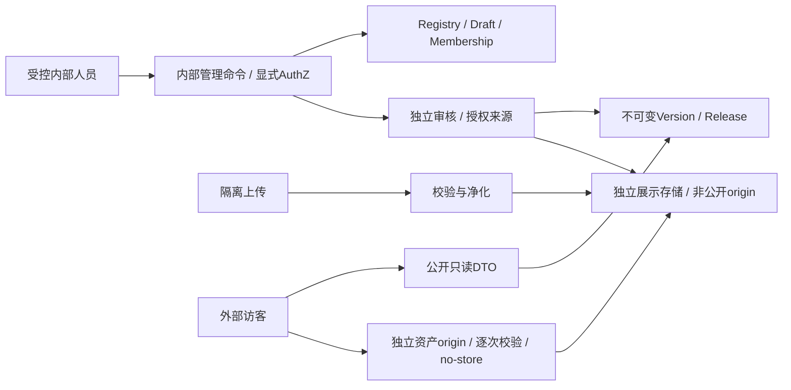

# 架构收敛与决策差异

本案沿用 main `e33ac216bdcffc44d12d4b7315e0d6cc48decf5c`，tree `8372e935e331688d6007b3433849c8efa8f6d10e`。Git 代理不可达；通过已连接 GitHub 的只读 branch API 核实 main。独立分支从本地 PR25 `a0050aaf4fc16e1cadd110918c3354a29e8d99fe` 建立，**同 tree、不同 commit 身份**，不冒称以 main commit 为父提交。原工作区及未提交修改见 evidence/baseline.json。

## 已读取输入与优先级

inputs 中复核报告、任务书、独立校验记录；archive/p0 中完整文档、Schema、OpenAPI、生成器、校验器与证据；当前固定源码及安全/数据库/设计文档；原始路线图全文均参与核对。哈希与位置见 evidence/baseline.json。

原路线图确实找到于 `D:/杂七杂八/AIG_Platform_Development_Roadmap_v1.0.md`，全文留存 inputs；因此本轮补上独立复核时的全文证据缺口。未取得路线图独立 Self_Audit 文件，不宣称核对了该文件。CTMR 的本轮论据来自固定 P0 取证，未重新运行或证明私有仓库最新状态。

冲突优先级：本轮用户范围 > 当前源码事实/真实验收 > 本 P0.5 候选 > 原路线图长期规划 > 归档 P0。Owner 冻结前均为提案；不改变此前已验收 Landing 设计方向。

| 原路线图 | 本轮收敛 | 判定 |
|---|---|---|
| §0/2 Project 一级对象，AI Hub 子板块 | Registry 独立；旧 AI 服务不重写 | 一致 |
| §3 当前 Landing 原样保护、Claude 视觉主责 | 源码哈希与参数锁定；无 UI diff | 一致；运行 golden 缺失 |
| §5 三类可见性与资源权限分离 | Private 只内部授权读；Public/Unlisted 发布投影独立 | 一致 |
| §6/7/10 长期 BYOK、Remote、发布向导 | 只规定未来约束；P1 不部署这些接口 | 分阶段缩减，不取消长期方向 |
| §8 最小 ERD、RLS/GRANT/服务端/JWT | 新 8 实体，不建 Run/Vault/Installation | 一致，未执行迁移 |
| §9/15 CTMR 和非 AI 项目适配 | 通用研究声明与合成非 AI fixture；3D 产物可登记但 P1 只放审定栅格预览 | P1 Viewer 明确缩减，非全平台验收 |
| §10 P1 最小后台，P3 完整发布协议 | 最小内部命令提前到 P1，外部自助发布/Portal 仍 P3 | 显式依赖调整，待 Owner 批准 |
| §10.1 最小隔离验证 | 先批契约与测试计划，flag 关闭实现中完成真实隔离测试，开放前验收 | 避免先实现测试的循环门禁 |
| §12/13/14 审计、门禁、Owner | 不部署、不合并、不代签 | 一致 |

## 最小架构

内部操作者 = 服务器维护的有效内部资格 + 项目角色；Supabase 登录、Profile.ADMIN 或 JWT user_metadata 均不能单独赋予发布权。身份沿用现有 auth user UUID；Membership 在 P1 由受控配置建立，不做自助邀请、转移、多组织。

新路由限定 `/api/v1/projects` 和 `/internal/v1/projects`，资产使用独立 origin 上 `/releases/{releaseId}/assets/{assetId}`。不改旧 `/api/chat`、Tools、Persona、Memory、Agent、SSE、UsageLedger、`/workspace`、`/enter` 语义和用户 ID；不修改现有 Prisma enum。新增 read model 不回查旧用户结果。

## 四类接口与未来边界

1. Public API：GET 目录/当前发布/指定发布/文档；只读已发布投影。无用户数据、Run、源文件路径和 credential。
2. Developer management：内部限定命令，Supabase access token + 每次实时 internal allowlist/项目角色校验；外部开发者写入仍禁用，未来 Console 仅消费此契约而不得自动开放。
3. Compute/Job：未来独立前缀 `/api/v1/jobs`，本 OpenAPI paths 不列为 P1 operation。计算选择 `{kind: REGISTERED_REMOTE, endpointRevisionId, operationId}` 与凭据选择分开。非 Provider 算法为 `{kind: NONE}`；Provider 才选 `{kind: PLATFORM_PROVIDER, providerRef, model}` 或 `{kind: USER_CREDENTIAL, credentialId, grantId, providerRef, model}`。端点 revision、模型、版本、输入 Schema/hash、grant 都封存；未知组合拒绝，绝不隐式回落或由前端指定 URL。无 API key 内容进入快照。
4. Credential/BYOK：未来独立前缀，返回只含脱敏元数据，永不提供读明文/密文公共接口。长期模式待 KMS/AEAD/轮换验证；SESSION 首版排除。未来受限代理票据绑定 subject、version、capability、audience、nonce、expiry、模型白名单、原子预算上限及子调用额度；远端不能自由委派。费用未知时 fail-closed，未知 Provider 副作用先对账，不盲重试。

未来这两类只是设计边界，没有新增实时入口、URL proxy、远程 fetch、第三方执行或密钥读取。multipart/分块留 P4，P1 内部静态上传仅单对象≤2MiB有界字节流，不借用旧 Run 上传接口。未来路由机器候选见contracts/futurerouting.schema.json，仅描述服务端封存选择，不是已开放请求DTO。

## 合同版本与哈希

P0 `1.0.0` 候选存在破坏性修订：新候选统一 `0.5.0`，不宣称兼容旧 payload，也不是已发布 API 降级。OpenAPI 使用 3.1.0 + JSON Schema 2020-12，以离线 validator 验证；归档 3.2.1 是合法标准，并非版本错误。尚未跑任何 SDK/codegen，支持矩阵不冒称已验证；采用生成器前需独立消费编译测试。[OpenAPI 3.1 官方规范](https://spec.openapis.org/oas/v3.1.0)。

发布内容哈希定义为 `SHA256(UTF8(JCS(snapshot)))`，算法标记 `JCS-SHA256-v1`；拒绝重复 JSON key、非有限数、非 I-JSON/非法 Unicode；不做 Unicode 隐式归一化。对象按 RFC 8785 排序和数值规范化，不能用 Python sort_keys 冒充 JCS。字节资产另存 SHA256 原字节与净化后字节。参考测试验证批准摘要绑定，未实现完整 JCS；其跨语言向量是 P1 任务。[RFC 8785](https://www.rfc-editor.org/rfc/rfc8785)。

P1 不引入通用插件、Worker、复杂账单、通用网关或 CTMR 专用字段。审计/清理记录仅满足发布安全，不扩建全平台任务系统。
