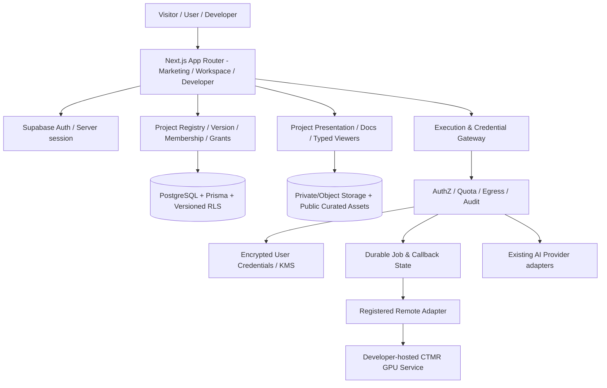

# AIG Platform · 平台化开发规划与实施契约

> **版本**：v1.0（规划稿，待项目所有者批准）  
> **编制日期**：2026-10-28  
> **状态**：DESIGN-ONLY / NOT IMPLEMENTED  
> **主要责任**：Codex — 架构、业务实现、算法、安全和测试；Claude — 交互、视觉、动效与视觉验收；项目所有者 — 范围、隐私策略、上线及最终验收。  
> **总目标**：以 AIG Platform 作为开发者项目的统一展示、文档、授权与运行门户；AI Hub 是其一项能力板块，而不是平台的产品定义。

## 0. 决策摘要（必须先读）

1. **保留当前已认可的公开主页设计**。不是重新设计。以当前 `main` 的真实 Landing 源码和项目所有者实际验收截图作为视觉权威；只演进信息架构、内容和新增页面。未经授权禁止删除、重写 Hero、导航、滚动与动效系统。
2. **Project 是平台一级业务实体**。Chat / Tools / Persona / Memory / Agents 继续工作，组合为 AI Hub；不得为了平台化而破坏现存用户数据、URL 和 API。
3. **Private 是多个独立维度**：项目可见性、用户数据可见性、密钥与运行授权分别治理。`UNLISTED` 不等于 `PRIVATE`。
4. **开放接入不等于运行任意第三方代码**。V1 从展示型接入和受控远程 API Adapter 起步；生产环境永不把外部代码直接放入 AIG 主站特权执行上下文。
5. **BYOK 不是一个设置输入框**。先有身份、最小权限、加密保管、凭据生命周期和出站访问控制，再开放跨项目模型调用。
6. **CTMR_4C 是第一项复杂参考项目**。保留独立 PyTorch / Python / CUDA 运行时；平台负责成果页、研究资料、结构化能力说明和（后续）受控异步调用。平台接口必须不依赖 CTMR 特有语义。
7. **首轮只审计和写规范**。Codex 不得在规划验收前更改 Production、合并代码、执行迁移或重新制作主页；Claude 不得先于接口契约构造假的产品能力。
8. **对现状保持可证实**。旧文档、README 阶段状态、源代码及 CI 可能不完全同步；出现冲突时以被指定 commit 的源码、版本化 migration 和真实验收为准。

## 1. 源码基线、发现与可信度

### 1.1 本次查看的仓库基线

| 仓库 | 目标 | 当前阅读快照 | 说明 |
|---|---|---|---|
| [ManDik-Chan/AI-Generator](https://github.com/ManDik-Chan/AI-Generator) | AIG 平台演进主体 | `main`：`e33ac216bdcffc44d12d4b7315e0d6cc48decf5c` | 公开仓库；当前源代码中含独立 Marketing Landing 和 Workspace 路由 |
| [JNKL0620/CTMR_4C](https://github.com/JNKL0620/CTMR_4C) | 科研项目首个示范接入 | `main` Git Tree：`ddb510499a690c286ca607dc876d757c62662813` | 私有仓库；仅用于接入设计参考，不能公开复制代码或私有素材 |

**已检查的核心路径（示例）**：

- AIG Marketing：`app/(marketing)/page.tsx`、`features/landing/components/landing-page.tsx`、`features/landing/components/landing-runtime.tsx`、`features/landing/landing.css`、`features/landing/content.ts`。
- AIG Workspace：`app/(platform)/workspace/page.tsx`、`features/home`、`components/layout`；AI：`lib/ai/config.ts`、`lib/ai/providers/openai-compatible.ts`；数据：`prisma/schema.prisma`、`prisma/rls.sql`。
- 测试和部署：`.github/workflows/merge-gates.yml`、`.github/workflows/security-acceptance.yml`、`docs/security-audit-2026-07-22.md`、`docs/security-hardening-deployment.md`。
- CTMR：项目说明文件、`main.py`、`core/reconstruction.py`、`core/segmentation.py`、`core/detection.py`、`ui/`、`services/`、`requirements.txt`。

### 1.2 需要显式澄清的现状

- 当前公开 Landing 使用单独的 `.lp` 样式命名空间；可从源码确认**浅纸色、深墨色、局部黄绿强调**与独立滚动/动效运行时。`docs/design-system.md` 的 Lumen 紫色系与应用壳规范描述的是其他/较早 UI 基线，**不能直接作为新 Landing 的重做指令**。当前视觉快照仍须由项目所有者确认并存档。
- `app/(platform)/workspace/page.tsx` 与 `features/home` 构成登录后的工作台；新开发者平台需要保留现有认证和 AI 功能迁移入口，不得把该页面与公开 Landing 混为一谈。
- `prisma/schema.prisma` 已有 `Profile`、`UsageLedger`、`ToolRun`、`GenerationRun`、`Persona`、`Conversation`、`Memory`、`AgentRun` 等，但未发现完整的第三方项目注册、安装授权、发布、凭据 Vault、统一项目运行实体。以下数据模型均为**提案，不表示已实现**。
- 当前 Provider 以服务端 `AI_BASE_URL` / `AI_API_KEY` / `AI_MODEL` 配置为主，并通过 OpenAI-compatible Adapter 提供能力；尚不能把它等同于用户级 BYOK。
- 历史安全审计指出异步任务耐久性、上传体积、授权和 CI 真验收等风险；需要避免已有 `waitUntil`/`after` 逻辑被误当成跨实例可靠队列；可能已有后续修复，**必须重新核验当前 commit 与真实测试**，不能照搬历史缺陷为“仍未修复”。
- 已合并的 Landing PR #25 并不等于每条生产门禁都已证明通过。P0 阶段重新取证 `main` 的当前 CI、所需 checks、Preview、真实浏览器与数据库验证。
- CTMR 项目说明宣称 DICOM / NIfTI、GhostFocusNet、LightM-UNet、三维重建、RAG 等能力，但说明中的旧 Web 目录与当前仓库树并非完全吻合；Mamba/Transformer 具体实现位置、训练权重、性能结果和 Web API 可用性必须逐项核验，不把宣传性文本当事实。

## 2. 产品定义与用户旅程

### 2.1 定位

**AIG Platform = 隐私优先的开发者成果发布、技术展示与受控运行平台。**

主体对象不是“AI 生成请求”，而是 **Project（项目）**。每个项目可以是科研模型、完整 Web 服务、算法 Demo、工程工具、独立软件或 AI 应用。项目可以只展示、不运行；也可以通过显式适配协议提供实时交互。

### 2.2 用户类型

| 角色 | 核心需求 | 禁止/限制 |
|---|---|---|
| Visitor（访客） | 浏览公开项目、阅读公共文档、试用明确公开的静态 Demo | 不得看到 Private 项目、用户私有资产、密钥或特权 API |
| User（普通用户） | 收藏/安装项目、运行获授权能力、管理个人数据和自己的 Provider 凭据 | 无权访问他人的运行历史和项目管理 |
| Developer（开发者） | 管理自己的项目、发布版本、编写文档、观察汇总使用状态 | 不因“项目作者”而获得使用者的数据或 BYOK 明文 |
| Project Collaborator | 在指定项目中具有受限开发/编辑/发布权限 | 不获得同所有者其他项目或平台管理员权限 |
| Platform Admin | 审核公开发布、处置滥用、保障平台安全 | 管理操作必须可审计；默认无权读取用户私有正文/明文密钥 |

### 2.3 三条关键旅程

1. **科研成果展示**：访客打开 CTMR 页面 → 阅读研究摘要、技术框架、真实实验结果 → 使用获准的匿名样例操作 3D Viewer → 阅读模型卡和 API 文档；即使没有 GPU Worker，页面仍完整可用。
2. **开发者发布**：登录 → 创建项目 Draft → 上传/填写 Manifest 与 OpenAPI → 运行契约检查 → 创建 Preview → 审核权限和资产 → 发布 → 获取稳定版本页与变更记录。
3. **用户授权调用**：登录 → 选择项目及具体能力 → 查看数据去向、费用/额度和所需权限 → 明确授权 → 运行任务 → 观察进度与结果 → 撤销授权/删除数据。对于 AI 请求，用户可以再选择是否使用自己的 Provider 凭据。

### 2.4 V1 非目标（明确禁止范围蔓延）

- 非第三方任意代码托管、容器租赁或开放式 GPU 云。
- 非未经审核的插件商店；不自动安装依赖、执行任意 Shell、Git 操作或上传脚本。
- 非外部开发者可绕过网关直接读取用户 API Key。
- 非医疗诊断产品，也不使用真实患者案例作为首轮演示数据。
- 非一次性重写聊天、长期记忆、现有 Agent 和用户体系；不在首版开发多组织计费、复杂收益分成和开放市场结算。
- 非统一替换当前 Landing 的视觉体系。

## 3. 信息架构与现有设计保护

### 3.1 建议导航（可由 Claude 基于真实数据细化）

| 区域 | 公开 / 登录 | 包含内容 | 迁移策略 |
|---|---|---|---|
| Explore | 公开 | 项目目录、精选成果、科研项目、标签与搜索 | 新增，不引入假计数/假项目 |
| Project Showcase | 公开/按权限 | Overview、Architecture、Demo、Benchmarks、Docs、Releases | 新增通用模板 + CTMR 专项可视化插件 |
| Workspace | 登录 | 我的应用、项目运行、私有成果、个人数据、Connection | 增量扩展 `workspace`，保留旧工作台入口 |
| Developer | 登录/授权 | 项目、Manifest、构建校验、版本、发布管理、文档 | 新增 |
| AI Hub | 登录 | Chat / Personas / Memories / Tools / Agents | 路由先兼容，导航重分组；数据和执行链不重写 |
| Account & Privacy | 登录 | 数据范围、分享授权、凭据、导出/删除、审计记录 | 增量扩展现有账户模块 |

### 3.2 不可回归的公开 Landing 契约

**来源**：当前仓库 `features/landing/*` 的真实实现 + 项目所有者已验收的视觉效果，而不是过期设计文档里的抽象配色描述。

- 保留 `.lp` 的独立样式命名空间、字体节奏、12 栏/响应式布局、浅纸色与深墨色色彩关系、局部强调色和整体编辑式气质；新的设计 Token 应区分 **Marketing** 与 **Workspace**，避免强行混色。
- 保留当前 Hero 纵深卡片扩张、中心区域排版避让、滚动章节、遮罩/过渡、指针微动、文字动效、动效节奏；是否修改视觉逻辑须取得单独的主人验收。
- 公开首页的内容可以从 AI 功能介绍改为平台/项目价值叙事；但 **改文案和信息结构 ≠ 重写视觉动效**。
- 必须建立已验收桌面/手机截图和至少一段动效录屏作为 visual golden baseline（静态截图不足以锁定运动时序）；提交 `docs/design/platform-visual-contract.md`、`docs/design/landing-motion-invariants.md`。CI 或视觉验收对比基线应标明更新原因及所有者批准。
- 320 / 390 / 430 / 768 / 1024 / 1440 / 1920 宽度、键盘/触屏、reduced-motion、无 JS 首屏都要检验。已知源码中存在 `preloader`，应特别验证无 JS 下不会永远挡住内容。
- 任何新增 CTMR 交互界面应遵循平台整体视觉气质，但科研 Viewer 可保留密集工具栏和专业图层控制，不为了统一风格牺牲使用效率。

## 4. 平台总体架构



**信任边界**：

- **平台可信域**：身份验证、业务授权、项目版本、密钥加解密、审计、上传资产所有权、任务状态机。
- **第三方不可信域**：项目作者控制的 Web 前端、远程推理服务器、项目描述、Manifest、OpenAPI、用户提供输入文本及外部 API 返回值。
- **用户专有域**：用户输入/文件、运行结果、个人 Provider 凭据、授权记录。即使运行公开项目也不自动公开这些内容。
- **高敏感医学域**：DICOM 头、像素中的身份文字、NIfTI 元数据、病例相关模型产物；默认只用合成或明确批准且充分去标识化的数据作为演示。

**部署原则**：保留 Next.js + Supabase + Prisma + Vercel 主架构；长时间/GPU 作业通过远程 Worker/持久队列解决，不让 Vercel Function 承担数分钟甚至数十分钟的完整训练/重建任务。队列技术选型由 P0 Spike 确认（可靠投递、去重、超时、续跑、成本均要验证），不预设 Kafka/Redis 为必选。

## 5. 权限、Private 与数据治理（发布阻断项）

### 5.1 三种隔离维度不能混用

| 维度 | 建议模型 | 判定规则 |
|---|---|---|
| 项目可见性 | `PRIVATE / UNLISTED / PUBLIC` | Private 需成员/所有者验证；Unlisted 仅不在目录列出，拿到链接的人仍可见公开内容；Public 可被发现 |
| 资源可见性 | `OWNER_ONLY / PROJECT_COLLABORATORS / EXPLICIT_SHARED / PUBLIC_ASSET` | 每个输入、结果、文件、笔记、任务独立定权；不得根据 Project=PUBLIC 推断结果 Public |
| 能力授权 | `Grant(subject, projectVersion, capability, scope, expiry, status)` | 每次执行取当前有效授权；撤销后新调用立即拒绝，活跃任务按策略取消/失效 |

**权限判定样例**：开发者发布 Public 项目，并不因此可以查看用户上传的数据；普通用户使用 Private 项目需成员邀请；管理员可审核公开文案但非默认拥有密钥和医学数据读取权。

### 5.2 建议的数据治理接口

- 数据在收集前提供用途说明和处理者/目的地；显式区分平台处理、外部 Provider 处理和开发者自托管处理。
- 项目数据支持按资源删除、账户级导出与删除申请；数据留存及跨境/第三方处理在开放前经合规与用户告知审查；签名 URL 有时效，删除必须覆盖元数据、对象存储及衍生结果，备份处理按公布的保留策略执行。
- 默认禁止公开展示用户运行结果；分享必须由所有者主动发起，生成独立可撤销分享授权，敏感资产不支持公开分享。
- 设置内容保存策略（例如：无内容模式只保留必要的额度/状态审计），但不能误称“关闭历史”就完全不处理或不保留任何数据。
- 数据跨服务流转记录 processor、purpose、retention、data class；对开发者可见的日志只包含匿名聚合、错误码及项目维度计数。

## 6. BYOK / Credential Gateway

### 6.1 两种使用模式

| 模式 | 说明 | 数据/费用原则 |
|---|---|---|
| Platform-managed | 用户使用平台预配置的受控 Provider（若开放） | 平台规则与限额生效，必须公开成本/配额与处理方 |
| Bring Your Own Key | 用户绑定自己的 Provider 与模型 | Provider 可能直接向密钥持有人计费；AIG 仍需要计算平台调用资源/防滥用额度 |

**用户必须明确选择 Provider / Credential / Model**。不应在 BYOK 失败时静默换为平台 Key 或其他第三方服务，避免隐形费用及隐私转移。

### 6.2 存储与调用规范

- `Credential` 的元数据与加密载荷分离；使用认证加密（AEAD）、独立随机 nonce、主密钥由 KMS/托管 Secret Service 管理；支持密钥版本、轮换、审计、撤销和销毁。**禁止将密文等同于“绝对无法访问”**：平台服务端为调用 Provider 需要在受控时刻解密。
- Key 永远不能出现在 `NEXT_PUBLIC_*`、客户端 JS、URL Query、SSE、日志、错误文本、数据库明文字段、审计事件正文或第三方 SDK 的 payload。
- “仅本次使用”也可能由服务端短暂持有，应定义清楚生存期、临时凭据消除机制和不可持久化保证，不作端到端加密承诺。
- Provider Endpoint 白名单优先；自定义 Base URL 初期禁用或严格审批。防 SSRF：禁止本机/内网/metadata 目标，防 DNS rebinding，校验解析后的所有地址，限制重定向，限制协议/端口和域名，网络 egress 控制为最终防线。
- 跨项目调用使用 `CredentialGrant`（user、credential、project、capability、audience、expiry）。开发者只能调用平台代理能力，**不拿到原始用户 Key**。某些远程自托管项目无法在不接收用户数据的情况下计算，应如实提示“数据将交给该开发者运营的服务”，并让用户单独同意。
- 不将用户 Key 用于跨用户任务、平台后台 Memory 自动提取或未授权的 Agent Worker。每一种后台子调用必须明确落在授权能力范围和额度范围内。
- 配额、成本、限流以及取消/失败记录接入既有 `UsageLedger` 思路；平台运行额度与用户 Provider 账单必须分开显示。

### 6.3 基本测试

禁止：用户 A 调用 B 的 Key、禁用 Key 继续使用、伪造 projectId 获授权、日志泄密、通过自定义 Base URL 发起内网请求、将 Key 传给开发者 iframe、模型切换导致隐藏收费。允许：用户主动解绑、轮换、查看脱敏 Provider 状态、查看自己已授权的项目和撤销授权。

## 7. Developer Integration Contract（先做展示，再做执行）

### 7.1 接入等级

| 级别 | 能力 | 开放顺序 |
|---|---|---|
| L0 — Showcase | 成果页、技术说明、Model Card、静态数据集/公开素材、下载链接 | 首先实现；无外部代码执行 |
| L1 — Verified Embed | 受控沙盒交互（独立 origin/iframe）；可信通信协议、没有平台 Cookie/Token | 在安全验收后开放 |
| L2 — Remote API | OpenAPI 契约 + 平台统一任务代理、权限、上传、状态与结果 | 在 Gateway 和异步任务稳定后开放 |
| L3 — Platform-hosted Runtime | 平台托管隔离容器、GPU/成本预算、准入审核 | 后期探索，V1 不实施 |

### 7.2 Manifest 规范草案（**示例，不是已上线 Schema**）

```json
{
  "schemaVersion": "1.0.0",
  "projectId": "ctmr-4c",
  "version": "0.1.0",
  "name": "Medical Imaging Reconstruction",
  "category": "research",
  "visibility": "PUBLIC",
  "integration": {
    "mode": "REMOTE_API",
    "openapi": "./openapi.yaml",
    "endpointRef": "registered-ctmr-prod"
  },
  "capabilities": [
    "documentation.read",
    "visualization.mesh3d",
    "inference.reconstruction.async"
  ],
  "dataPolicy": {
    "publicDemoData": "curated-synthetic-only",
    "requiresExplicitConsentForRemoteProcessing": true
  }
}
```

规范要求：Schema 校验与版本兼容；字段白名单；避免把任意用户提交的 `endpointUrl` 当成请求目的地；Manifest 必须绑定特定发布版本的不可变快照，不能随着外部文件变化悄悄扩权。危险能力变更须重新审核/重新获取用户授权。

### 7.3 平台 API 规范（拟议路径，非现有 API）

```text
GET    /api/v1/projects                      # Public/authorized list
GET    /api/v1/projects/{projectId}          # Authorized read
GET    /api/v1/projects/{projectId}/versions/{version}
POST   /api/v1/projects/{projectId}/installations
POST   /api/v1/installations/{id}/grants
DELETE /api/v1/grants/{grantId}
POST   /api/v1/projects/{projectId}/runs     # async run, Idempotency-Key
GET    /api/v1/runs/{runId}
POST   /api/v1/runs/{runId}/cancel
POST   /api/v1/runs/{runId}/artifacts/upload-intents
GET    /api/v1/runs/{runId}/artifacts/{artifactId}
```

- `POST /runs` 返回 `202 Accepted` + `runId/statusUrl`，不得假装同步完成 GPU 推理；输入与输出均需限额、文件扫描与内容类型校验，按项目设置并发、运行时长、存储、带宽和预算上限，可由平台熔断/停止。
- 任务状态：`PENDING → ACCEPTED → RUNNING → {SUCCEEDED, FAILED, CANCELLED, TIMED_OUT}`；必须定义合法转换、终态幂等和竞态处理。第三方回调须 HMAC/mTLS/OIDC 一种经过测试的签名身份机制，并具备 timestamp/nonce/重放防护。
- 所有 API 均进行服务端 owner/project-version/Grant 校验；读写结果不能只靠浏览器参数或展示层隐藏。
- 大文件采用短时 upload-intent + 对象存储直传 + finalize 校验，不通过 Vercel 单次请求体转发 DICOM 序列。
- 响应声明有稳定 `error.code`、`requestId` 和版本；不能向客户端或作者返回原始密钥、内部 URL、未脱敏追踪数据。
- 描述 API 采用 **OpenAPI 3.1.x** 作为初期工具链兼容目标；正式采用版本需以真实验证的 SDK/校验器兼容性决定。2026-09 已发布 OAS 3.2.1，文档不应错误声称 3.1 是最新。

### 7.4 独立展示层协议

除了 OpenAPI，还需要平台自身的 `Presentation Schema`（版本化），将成果页和运行输出表示为可验证的类型：

- `document.markdown`、`metric.series`、`image.tile`、`volume.medical`、`mesh3d`、`labelmap3d`、`report` 等；每个类型有 `mime`、尺寸/格式限制、资源权限、预览策略、可访问性文本。
- Viewer 是受信任平台组件或独立审查的隔离组件，不能把外部 Markdown、任意 HTML/SVG 直接拼入宿主 DOM。页面数据一律视为不可信输入。
- 第三方互动页面使用独立站点 origin、CSP、iframe sandbox、`postMessage` 严格 origin / 消息 schema 校验，禁止双向自由传 Cookie/Token；对 CSP/allow-scripts/allow-same-origin 的组合做真实安全评审。

## 8. 数据模型提案（非 migration）

| 实体 | 核心字段（示例） | 必要约束 |
|---|---|---|
| `Project` | `id, ownerId, slug, visibility, status` | 唯一 owner+slug；Public/Unlisted/Private 授权谓词 |
| `ProjectMember` | `projectId, userId, role, invitationStatus` | 同项目授权，角色最小化，不继承管理员权限 |
| `ProjectVersion` | `id, projectId, semver, manifestHash, releasedAt` | 发布后不可变；版本指纹、唯一性 |
| `ProjectDocument` | `projectVersionId, kind, storageKey, visibility` | 文档权限不低于项目规定；防越权 |
| `ProjectAsset` | `projectVersionId, ownerId?, kind, storageKey, visibility` | 独立鉴权；公开资产白名单；元数据和对象一致删除 |
| `ProjectInstallation` | `userId, projectId, versionId, status` | 用户安装授权独立于项目公开状态 |
| `ProjectGrant` | `installationId, capability, scope, expiresAt, revokedAt` | 能力范围可审计，撤销拒绝新任务 |
| `Credential` | `userId, provider, maskedHint, encryptedRef, keyVersion, status` | 仅用户管理；不可通过浏览器直接读密文、关联及元数据也需 owner scope |
| `CredentialGrant` | `credentialId, projectId, capability, expiresAt, revokedAt` | 与 ProjectGrant 双重校验，不能隐式授权 |
| `ProjectRun` | `userId, projectId, projectVersionId, status, idempotencyKey, quotaRef` | 终态不可逆、并发唯一、仅自己可读、复用账本原则 |
| `RunArtifact` | `runId, ownerId, type, storageKey, retentionUntil` | 上传验证、短期访问签名、生命周期清理 |
| `AuditEvent` | `actorId, action, resourceRef, result, timestamp` | 不能记录 Key/完整敏感 payload；有独立保留策略 |

**迁移方式**：先输出 ERD + SQL/RLS 草案并做安全审计；随后仅通过新、可回滚或可前向兼容的 Prisma migration 增量部署。不得修改已应用 migration 的历史内容；`prisma/rls.sql` 只作灾难恢复参考而不是常规发布步骤。RLS + SQL GRANT + 服务端显式范围校验 + 真实 authenticated JWT 测试必须形成四层防线。

## 9. CTMR_4C 首个完整接入案例

### 9.1 研究展示页模块

| Tab | 用户可见内容 | 数据来源与状态 |
|---|---|---|
| Overview | 项目动机、研究目标、作者贡献、限制 | 由开发者审定的真实文字 |
| Architecture | 真实网络拓扑、Mamba/Transformer 的实际实现位置、检测/分割/重建流水线 | 以代码、实验报告和依赖图核实；不能杜撰网络层 |
| Model Card | 权重版本、输入数据、训练/推理环境、限制和适用范围 | 每个模型有明确验证状态及版本 |
| Benchmarks | Dice/mAP/延迟/显存/数据集/置信区间与实验设置 | 仅真实实验结果；无测量数据则显示“未发布”，不伪造 |
| Interactive Lab | 合成或授权匿名样例的切片浏览、mask 叠加、3D 网格、标签切换 | 优先静态/预计算 Demo，后期接异步 GPU 任务 |
| API & Docs | OpenAPI、payload schema、错误码、使用示例、部署指南 | 随 ProjectVersion 固定 |
| Releases | 算法版本、权重校验、Breaking Changes、可回滚版本 | 不能仅修改前端版本号 |

### 9.2 CTMR 真实能力核验表（启动时由 Codex 填写）

| 声称能力 | 仓库中已看到的线索 | 验收前待确认 |
|---|---|---|
| DICOM / NIfTI 导入 | 项目描述与 Python 图像处理依赖 | 文件类型、解码边界、脱敏、大小与真实样例测试 |
| 病灶检测 | `core/detection.py` 提供模型推理线程 | 实际权重、模型来源、输入输出、准确性证据 |
| 分割 | `core/segmentation.py` 中有阈值 mask 与去噪；说明还提及 LightM-UNet | 哪条路径实际调用何种模型，训练权重是否可用 |
| 三维网格 | `core/reconstruction.py` 使用 PyVista 等构建网格 | 体素方向、spacing、mesh 质量、文件格式及 Viewer 兼容性 |
| Mamba / Transformer | 项目说明与依赖可见部分线索 | 模型代码定位、实际推理链、基线消融实验 |
| RAG 报告 | `services/rag.py`、项目说明 | 知识来源、数据隐私、安全声明、是否可在演示环境实际运行 |
| 远程 Web API | 历史文档提到 React/Django，当前根目录结构有所变化 | 先枚举真实启动入口与可调用端点；不存在就规划 Adapter，不能假装可用 |

**首个 Demo 排序**：① 公共成果展示 + 预计算的合成 3D 资产 → ② 本地受控 Adapter + 测试数据的异步任务 → ③ 封闭测试用户的远程推理 → ④ 经合规/安全与部署验收后再考虑更敏感数据。真实医学影像的去标识化必须考虑 DICOM header、私有标签、烧录在像素内的文字以及衍生结果；脱敏不应被表述为零风险。研究演示**不是临床诊断**。

## 10. 分阶段开发计划与执行门禁

以下阶段是**依赖和验收驱动的实施顺序**，不是虚构工期。每个阶段独立 feature branch / PR，不允许混合不相关的视觉重构、API 修改和数据库变更。

| 阶段 | Codex 主要交付 | Claude 主要交付 | 必须通过的 Gate |
|---|---|---|---|
| **P0 现状与安全基线** | Source Audit、CI/branch rules、ERD 草案、威胁模型、过期文档差异、CTMR 核验计划 | 公开 Landing 真实视觉快照/动效基线、视觉契约 | 基准 SHA 和待办已登记；不修改业务；owner 审批 |
| **P1 Project Showcase MVP** | Project/Version 只读模型、最小后台、Public/Private 授权、Model Card/Docs 静态管线、真实 CTMR 样例 | 基于现有语言设计 Explore、Project Detail、Research Showcase | 公共/私有隔离、无假指标、关键视觉回归、可离线展示 |
| **P2 Private & Permission** | ProjectMember/Installation/Grant、RLS/GRANT、资源访问控制、审计/撤销与删除 | 授权流程、隐私控制、错误/空状态体验 | 跨用户/越权/撤销/资源签名 URL/导出删除测试通过 |
| **P3 Integration Spec & Developer Portal** | Manifest Validator、OpenAPI 检验、版本发布、Remote Endpoint Registry（不开真实执行） | 开发者发布向导、接口文档阅读体验、状态反馈 | 错误 Manifest/版本冲突/恶意 endpoint 被拒绝，文档可复现 |
| **P4 Runtime Gateway（测试数据）** | 异步 ProjectRun、上传意图、可恢复状态机、签名回调、隔离远程 Adapter | 运行进度、历史、Viewer、取消与失败恢复 | Kill/retry/timeout/replay/SSRF/10MB+ 分块/权限测试；无真实医学数据 |
| **P5 BYOK & AI Hub 整合** | Vault/KMS 方案实现、用户 Credential 与 Scope Grant、Provider Router、用量分离；原 AI 路由兼容 | Connection、授权、AI Hub 新导航及迁移体验 | Key 不泄露、跨项目隔离、费用边界正确、旧 AI 回归通过 |
| **P6 CTMR 受控端到端接入** | CTMR Adapter、科研资产、模型版本映射、受控 GPU Worker、复现数据 | 专业 3D Lab、测量/图层交互、Research Story | 合成样例完整链路、设备/性能、权限、安全与医学风险检查 |
| **P7 开发者 Beta 发布** | 文档站、SDK、版本兼容性、审计与运营告警、发布审查机制 | 全站一致性、可访问性和动效/性能验收 | Owner 决定开放人数、支持范围与回滚；不自动开放任意代码托管 |

### 10.1 阶段依赖细则

- P1 可先做只读/静态 Project Showcase，不依赖 BYOK 或 GPU；但必须已有最小 Public/Private 授权验证。
- P2 的数据隔离和执行授权是 P4/P5 的安全前置；仅完成展示权限不允许开放第三方运行。
- P3 提供协议，P4 才调用远程服务；P4 初期只允许内置测试 Adapter 和合成数据。
- P5 不应改变现有 `lib/ai/providers/openai-compatible.ts` 的外部行为契约，优先新增选择层并保留平台配置兼容路径。
- P6 的 CTMR Adapter 可以并行实现，但真实推理上线必须等待 P2/P4 Gate 完成。
- Landing 信息架构的新文案可以与 P1 并行设计，**实装改动需在 P1 视觉基线冻结后单独 PR**。

### 10.2 每个 PR 的 Definition of Done

- 需求、非目标、风险、依赖、真实数据来源写进 PR；API 与 DB 改动附 Schema diff 和兼容计划。
- Codex 提供 `pnpm lint`、`pnpm typecheck`、`pnpm test`、`pnpm build`、`prisma validate` 的真实结果；涉及 Auth/RLS/运行/存储必须再跑隔离 Supabase、`test:rls`、集成/E2E；**测试失败即不能宣称 READY**。
- Claude 提供 Desktop/Mobile 对照、动效录屏、键盘与低动态偏好验收；记录相对当前视觉基线的有意变化。
- 代码 review 防止假数据、空按钮、未授权请求、日志中的用户数据、跨用户访问、未经授权的第三方入口。
- 若有生产 migration，遵循 expand → deploy → backfill/verify → contract 的向后兼容顺序；前置生产备份及明确回滚/前向修复方案。生产模型/API 的开放须经过正式安全评审、开关控制、异常告警与暂停机制。
- 每阶段 Owner 明确签署 `APPROVED` 或 `CHANGES_REQUESTED`。模型自行宣称完成不等于真实验收。

## 11. Codex / Claude 责任与交接契约

| 项目 | Codex 主责 | Claude 主责 | 冲突处理 |
|---|---|---|---|
| Prisma、RLS、Auth、数据权限、密钥 | 设计、实现、测试 | 提出交互需求，但不得直接修改权限逻辑 | Owner 审批变更记录 |
| OpenAPI/Manifest/SDK、Adapter、队列、算法 | 设计、实现与版本兼容 | 依据真实 Schema 做信息展示 | API Proposal → Review → Freeze |
| Landing、Explore、Project Detail、3D Lab 的视觉与动效 | 仅作必要集成、不擅自改设计 | 视觉设计、实现/指导实施及验收 | 以主人批准的视觉基线为准 |
| 安全与可访问性 | 服务端安全、边界测试 | 可访问性、隐私告知、权限可理解性 | 两侧 Gate 均需通过 |
| 合并/部署/生产数据库 | 准备候选与报告 | 视觉确认 | Owner 最终批准；主线受保护 |

**实际交接结构**（建议写入 `docs/platform/`，而非把决定只留在聊天里）：

```text
docs/platform/
  00-product-vision.md
  01-source-audit.md
  02-architecture.md
  03-permission-matrix.md
  04-security-threat-model.md
  05-data-model.md
  06-project-manifest.schema.json
  07-api-contract.openapi.yaml
  08-presentation-schema.md
  09-ctmr-reference-adapter.md
  10-release-and-test-gates.md
  11-decisions-and-open-questions.md
  design/
    platform-visual-contract.md
    landing-motion-invariants.md
    project-showcase-flow.md
```

交接流程：Codex PR（含 DTO、Schema、Mock 契约）→ Owner 审批契约 → Claude 设计/视觉 PR → Codex 与 Claude 分头复验 → 主人批准合并。不得在同一个工作树上由两名代理同时编辑相同文件。跨职责需求先提 Markdown RFC，不静默越界修改。

## 12. 测试矩阵和关键威胁

| 验收类别 | 必测案例 | 失败时处置 |
|---|---|---|
| AuthZ / IDOR | A 用户猜测 B 的 project/run/artifact/credentialId；访客访问 Private；开发者偷窥使用者结果 | 阻止合并 |
| RLS/GRANT | 真实 `authenticated` JWT 直接 PostgREST 修改 run/role/grant、跨用户读取 | 阻止迁移及发布 |
| Secrets | Key 进入日志、Preview、SSE、错误、浏览器网络、Git、审计；撤销后再次使用 | 阻止 BYOK 开放 |
| SSRF / Egress | 内网地址、云元数据、重定向、DNS rebinding、恶意 OpenAPI server URLs | 阻止远程 Adapter |
| Sandboxing | iframe origin、postMessage 源验证、CSP、同源 Cookie/Token 隔离、任意 HTML | 阻止外部 Embed |
| Async / Data | 并发幂等、取消竞态、重复回调、Worker 断电/部署回收、资源到期、上传未完成 | 阻止 GPU 实时调用 |
| Privacy / Medical | DICOM tag/烧录文本脱敏、匿名样例审查、共享及删除、数据处理告知 | 阻止真实医学上传 |
| Visual | Hero 运动、布局、遮罩、文本对齐、响应式、reduced-motion、无 JS | 回退视觉 PR |
| Compatibility | 旧 Chat/Persona/Memory/Tools/Agent、旧 URL、现有 Supabase 用户 | 阻止主线合并 |
| CI / Release | Node 22 + pnpm 11.7、required checks、隔离 Supabase、安全 E2E、Preview/Prod 环境区分 | 不能宣称 Production Ready |

参考基线：OWASP API Security Top 10（BOLA、SSRF、资源消耗等）、OWASP Secrets Management、DICOM PS3.15、MDN iframe sandbox。链接见附录。

## 13. P0 的真实输出（本规划获批后的第一轮任务）

**Codex 仅进行只读审计/设计文档；不要直接部署，也不要先建表。**

验收输出：

1. 仓库各分支与 `main` 的真实 HEAD/CI/PR 合并情况；必需检查清单和过去已知失败项是否已解决。
2. AIG 的路由、服务层、依赖、数据模型和信任边界现状图，识别可复用资产与需补能力。
3. Landing 当前批准视觉的源码清单、设计系统冲突清单，与 Claude 共享的视觉不可变约束初稿。
4. Project/ProjectVersion/Grant/Run/Credential 的 ERD、AuthZ Matrix、OpenAPI/Manifest/Presentation Schema 草案。
5. CTMR 的**已实现 / 已测试 / 仅声明 / 待开发**能力清单；找出真实 Python 推理入口、模型权重、输出文件及 Web Adapter 缺口。
6. 实施拆分表：各 PR 的文件范围、数据库迁移依赖、回滚、测试、Owner 审批关口。
7. `GO / NO-GO` 审计结论；列出阻断项，不得以文档完成替代实际安全验收。

### 13.1 可直接给 Codex 的提示词

> 你负责 AIG Platform Core 的第一轮**只读架构审计与设计规范**。从当前 `main` 拉取并锁定 SHA，阅读真实源码、Prisma migrations、RLS/GRANT、安全审计和 CI。将 AIG 从 AI-Generator 演进为 privacy-first developer project platform，Project 为一级实体，AI Hub 为子模块。保留现有 Chat、Memory、Tools、Agents、Auth、数据与 API 行为；不得推倒重做。**公开 Landing 由 Claude 交付并已获主人认可，必须原样保护当前 `features/landing/*` 的视觉/动效语言，旧 Lumen 文档不可覆盖当前基线。** 设计 Project Registry、ProjectVersion、Private/Unlisted/Public、用户数据隔离、ProjectGrant/Installation、BYOK Vault 和最小权限代理、受控远程 Adapter、Manifest + OpenAPI + Presentation Schema、可恢复 ProjectRun。以 CTMR_4C（独立医学影像模型/三维重建）作为复杂参考案例，核查真实功能，不得虚构能力。输出 `docs/platform/` Markdown/JSON Schema/OpenAPI 草案、ERD、权限矩阵、威胁模型、差距分析、PR 拆分和 QA Gate。**本轮不改业务代码、UI、生产数据、CI required settings，不执行迁移、不合并、不部署。** 所有结论标注 Verified / Inferred / Unverified，最后进行独立自查并列出阻断项。

### 13.2 可在架构冻结后交给 Claude 的提示词

> 你负责 AIG Platform 的界面和交互演进。当前公开 Landing 的设计、字体排版、浅纸色与深墨色关系、Hero 纵深扩张、遮罩切换、滚动章节和细腻交互已获项目所有者认可，**不进行全站重新设计，不重写现有 Hero 逻辑，也不恢复旧 Lumen 主页**。在 Codex 冻结的 Project/Grant/Run/Presentation API 契约基础上，为 Explore、Project Detail、Research Showcase、CTMR 3D Interactive Lab、Developer Console、Workspace Connections 和 AI Hub 导航制作一致的真实设计。严格依赖已实现数据/明确定义的可选能力，不做假指标、假运行、无响应按钮。先交互说明和高保真视觉差异稿，经过主人批准后再实现；单独 PR，提交桌面/移动/低动态模式截图与动效验收，所有业务权限决策由 Codex 负责。

## 14. 待定决策（必须由主人选择后才进入相关实现）

| ID | 待定事项 | 默认推荐 | 影响阶段 |
|---|---|---|---|
| D-01 | 首轮是否允许外部开发者公开注册 | 先 Owner / 邀请制 Developer Beta | P1/P3 |
| D-02 | Private 是否允许受邀共同开发 | 支持明确邀请和角色审计，不开放组织多租户计费 | P2 |
| D-03 | 用户 API Key 是否支持长期保存 | V1 支持加密保存 + 本次会话模式；需先选 KMS | P5 |
| D-04 | 用户是否能自定义任意 Provider Base URL | V1 禁止，仅已审查的 Provider/Endpoint Registry | P5 |
| D-05 | 首轮是否开放外部 GPU 推理 | 仅经过审核的 CTMR 和合成测试数据 | P4/P6 |
| D-06 | 医学真实数据是否允许上传 | 默认不允许；另做安全、合规、数据治理评审 | P6 之后 |
| D-07 | 是否将 `ai-mdc.com` 做新的品牌命名 | 保留域名与现有品牌基底，名称可后续评审 | 视觉/营销 |
| D-08 | 是否增加平台托管任意项目源码 | V1 不开放，先远程 Adapter/静态 Showcase | P7 之后 |

## 15. 交付成功条件（产品层）

- 访客在不登录情况下浏览公开 CTMR 研究成果页，并清楚区分真实实验、项目声明和演示内容。
- 开发者能基于公开规范发布一个非 AI 项目，**不需要修改 AIG 核心业务代码**；这是检验“平台化”而不是“给 CTMR 定制 GUI”的核心指标。
- 普通用户可以使用被授权的项目，并从单一 Workspace 管理运行和输出；任何项目作者都不能默认浏览用户私有结果。
- AI Hub 保留并可通过用户自己的、经过授权的 Provider 进行调用；未配置 BYOK 的用户仍能使用当前已开放的合法路径。
- Landing 视觉/动效与已有验收保持一致，新增功能具有相同品质，旧账户和 AI 功能无回归。
- 项目从创建、审核、发布、调用、取消、结果展示、删除到撤销授权形成可审计闭环。

## 附录 A. 权威参考（供实现时再次核对）

**文档公开边界**：本规划包含私有 CTMR 仓库线索和内部阶段决策，初始按内部开发资料保管；若未来公开发行，仅保留经过作者允许的仓库链接、代码片段和演示资产。

- AIG 仓库：https://github.com/ManDik-Chan/AI-Generator
- CTMR 私有仓库（仅授权人员可访问）：https://github.com/JNKL0620/CTMR_4C
- OpenAPI Specification 3.2.1：https://spec.openapis.org/oas/v3.2.1.html
- OWASP API Security Top 10：https://devguide.owasp.org/en/07-training-education/07-api-top-ten/
- OWASP Secrets Management：https://cheatsheetseries.owasp.org/cheatsheets/Secrets_Management_Cheat_Sheet.html
- MDN iframe：https://developer.mozilla.org/en-US/docs/Web/HTML/Reference/Elements/iframe
- DICOM PS3.15（Security and System Management Profiles）：https://dicom.nema.org/Medical/dicom/current/output/pdf/part15.pdf

## 附录 B. 文档自查结果

> 自查报告单独保存在 `AIG_Platform_Development_Roadmap_v1.0_Self_Audit.md`。此处仅列检查范围：目标一致性、源码可证性、Landing 保留、Private 与权限分离、BYOK 安全、第三方信任边界、CTMR 真实性、开发责任、阶段依赖、CI/生产发布、兼容性与待决策。**本自查为规划文档审查，不代替真实代码审计、运行测试、医疗合规核验或 Owner 验收。**
